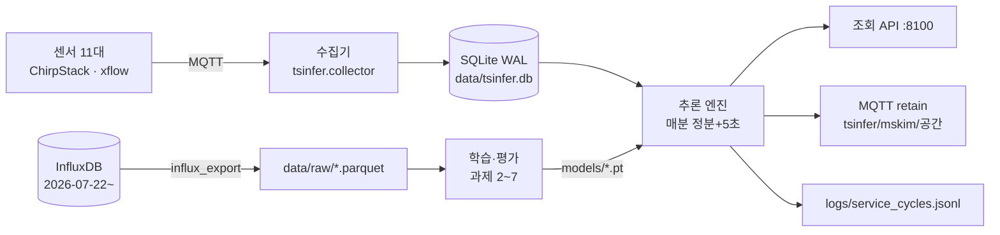

# 교육장 공기질 시계열 추론 — Jetson 상시 서비스 (AIP 3.2 개인 과제)

**한 줄 소개:** 교육장 4개 공간의 CO₂·온도·습도로 60분 뒤를 예측하고, 센서 고장과 환기 필요를 매분 알려 주는 서비스를 팀 Jetson Orin Nano 에서 상시 운영한다.
**해결하는 문제:** CO₂ 가 1,000ppm 을 넘은 뒤에야 환기하면 늦다. 30분 전에 미리 알리고, 센서가 멈추거나 튀면 사람이 알아채기 전에 표시한다.
**핵심 결과 (실측):** 기준선 '현재값 유지'의 60분 CO₂ 오차 실습실 40.0 · 사무실 46.4 · 회의실 65.1 ppm ([02_baselines](reports/02_baselines.md)) → 과제 3 목표는 이보다 30% 낮추기. 모델 결과는 아래 [결과 요약](#결과-요약)에 측정되는 대로 채운다.
**시연:** 조회 API `http://<jetson>:8100/docs` (형식 [docs/interface.md](docs/interface.md)), MQTT `tsinfer/mskim/<공간>` (retain). 영상은 12시간 가동 시험 때 녹화 예정.
**환경:** Jetson Orin Nano Super 8GB · JetPack 7.2.1 (L4T R39.2.1, Ubuntu 24.04, Python 3.12) · 전력 모드 MAXN_SUPER · 상시 사용 메모리 수집기 ≤300MB + 서비스 ≤1.5GB

과제 원문: `AIP-1/timeseries-inference` (이슈 curriculum#6) · 최종 보고서: [docs/report.md](docs/report.md) · 진행 체크리스트: [docs/progress.md](docs/progress.md)

**역할:** 개인 과제로 설계 판단·Jetson 실행·결과 해석은 민서가 했고, 코드 초안과 문서 정리에 AI 를 썼다(범위와 검증은 [보고서 7장](docs/report.md#7-ai-활용과-검증)). 제출 전 셀프 채점: [보고서 10장](docs/report.md#10-셀프-채점-추정-루브릭-a).

## 평가 항목별 근거 위치

과제 안내의 평가 비중(동작 25 · 성능 25 · 해석 30 · 공정한 평가 10 · 재사용성 10) 순서로, 각 항목의 근거가 있는 곳이다.

| 평가 항목 | 근거 | 위치 |
|---|---|---|
| 동작 (25) | 수집기·추론 서비스가 systemd 로 상시 가동, 재부팅 후 자동 시작, 12시간 가동 로그 요약 | [deploy/systemd](deploy/systemd), `logs/service_cycles.jsonl` → `python -m tsinfer.service.summary`, [보고서 1장](docs/report.md#1-동작) |
| 성능 (25) | 과제 3~7 확인 기준 대비 수치표 (같은 시험 시점) | [reports/](reports), [보고서 2장](docs/report.md#2-성능) |
| 해석 (30) | 데이터 진단서, 공간별 오차 원인, 가장 많이 틀린 상황, 의외였던 발견 | [02_diagnosis](reports/02_diagnosis.md), [보고서 3장](docs/report.md#3-해석) |
| 공정한 평가 (10) | 시간순 분할, 정규화는 학습 기간만, 모든 방법을 같은 시점에서 비교, 표마다 측정 조건 | [split.py](src/tsinfer/data/split.py), [보고서 4장](docs/report.md#4-공정한-평가) |
| 재사용성 (10) | 설정 파일만 바꾸면 되는 구조, 학습·서비스 공통 전처리, 테스트 38개, 일괄 실행 스크립트 | [configs/](configs), [tests/](tests), [scripts/run_all.sh](scripts/run_all.sh), [보고서 5장](docs/report.md#5-재사용성) |

## 구조



학습과 서비스는 같은 전처리(`tsinfer.data.preprocess`)와 같은 입력 생성(`forecast.make_windows`)을 쓴다. 학습 때와 서비스 때 입력이 어긋나는 것을 막기 위해서다.

```
configs/        default.yaml(공간·전처리·분할·임계값·공휴일) sensors.yaml(토픽 매핑) schedule.yaml(사용 여부 정답)
src/tsinfer/    collector/ 과제1 · ingest/ 과거 데이터 · data/ 과제2 · models/ 과제3~7 · service/ 과제8
deploy/systemd/ 재부팅 후 자동 시작 (user 서비스)
scripts/        run_all.sh 과제 2~7 보고서 일괄 생성
docs/           report.md 최종 보고서 · interface.md 결과 형식 · progress.md 체크리스트
reports/        과제별 결과 (Jetson 에서 생성 후 커밋, 측정 조건 포함)
tests/          pytest 38개 (합성 데이터로 각 과제 로직 검증)
```

## 기술 스택과 고른 이유

| 선택 | 고른 이유 | 버린 대안 |
|---|---|---|
| SQLite WAL | 수집기가 쓰는 동안 서비스가 읽어도 막히지 않고, 별도 서버가 필요 없다 | InfluxDB 직접 조회 (교육장망 밖에서 안 됨, 공용 서버 부하) |
| GRU, 변화량 목표·12칸 한 번에 출력 | 가장 강한 기준선이 '현재값 유지'라 그 위의 변화만 배우게 함. 반복 예측은 오차가 쌓인다 | 절대값 예측, 5분씩 반복 예측 |
| 규칙 + 오토인코더 결합 | 규칙은 값 고정·끊김을 확실히, 오토인코더는 잡음·드리프트를 잡는다 | 한쪽만 사용 |
| PyTorch CPU (학습), ONNX·TensorRT (과제 7) | 모델이 작아 CPU 로 충분하고, 공용 보드 GPU 를 비워 둔다 | Jetson GPU torch (설치 부담 대비 이득 작음) |
| FastAPI + MQTT retain | 조회는 API, 다른 시스템은 마지막 결과를 MQTT 로 바로 받음 | 웹소켓 |
| systemd user 서비스 + MemoryMax | 재부팅 후 자동 시작, 3명이 쓰는 8GB 보드에서 한 프로세스가 메모리를 다 쓰지 못하게 | tmux 수동 실행 |

## 설치와 실행 (Jetson, 복사해서 그대로)

```bash
git clone https://github.com/AIP-1-3/jenson_AIGJ_01_002.git ~/jenson_AIGJ_01_002
cd ~/jenson_AIGJ_01_002
python3 -m venv .venv --system-site-packages        # JetPack 의 TensorRT 바인딩 재사용
.venv/bin/pip install -r requirements.txt && .venv/bin/pip install -e .
.venv/bin/pip install torch --index-url https://download.pytorch.org/whl/cpu
.venv/bin/pip install onnx onnxruntime chronos-forecasting "numpy<2"   # 과제 6·7 (NumPy 1.26 유지)
cp .env.example .env && chmod 600 .env               # 접속 정보는 .env 에만 (저장소에 넣지 않음)
.venv/bin/python -m pytest                           # 38 passed
free -h                                              # 학습 전 여유 메모리 확인 (공용 장비)
```

```bash
# 1) 데이터: 과거(InfluxDB, 교육장망) + 실시간 수집기 상시 가동
.venv/bin/python -m tsinfer.ingest.influx_export --start 2026-07-01
cp deploy/systemd/*.service ~/.config/systemd/user/ && systemctl --user daemon-reload
systemctl --user enable --now tsinfer-collector tsinfer-service

# 2) 과제 2~7 보고서 (tmux 안에서, 6·7 은 팀 GPU 락 자동 사용)
./scripts/run_all.sh                 # 또는 ./scripts/run_all.sh 3 5
git add reports && git commit -m "과제 결과 보고서 갱신 (측정: Jetson, $(date +%F))" && git push

# 3) 서비스를 학습 모델로 교체, 상태 확인
sed -i 's/^SERVICE_MODEL=.*/SERVICE_MODEL=gru/' .env && systemctl --user restart tsinfer-service
curl -s localhost:8100/health
.venv/bin/python -m tsinfer.service.summary --hours 12   # 12시간 무중단 보고
```

과제별 명령: `tsinfer.data.baselines` · `tsinfer.data.diagnose` (2) · `tsinfer.models.forecast --compare-time --schedule` (3) · `tsinfer.models.anomaly` (4) · `tsinfer.models.state` (5) · `tsinfer.models.pretrained` (6) · `tsinfer.models.edge` (7) · `tsinfer.service` (8).

## 결과 요약

모든 수치는 Jetson 실측, 실데이터(InfluxDB iot-bucket + 수집기), 시험 기간 2026-10-06 이후. 측정 조건은 각 보고서 첫머리에 있다.

| 과제 | 확인 기준 | 결과 | 근거 |
|---|---|---|---|
| 1 수집 | 24h 커버율 ≥95%, 브로커 재시작 후 1분 내 복구, 재부팅 후 자동 시작 | 수집기 상시 가동 중 (11개 장치, 4개 공간). 커버율·장애 시험 기록 예정 | [collector](src/tsinfer/collector) |
| 2 기준선 | 기준선 3종 × 5·15·30·60분 MAE | 현재값 유지가 모든 공간에서 최선, 60분 CO₂ 40.0 / 46.4 / 65.1 ppm | [02_baselines](reports/02_baselines.md) |
| 3 예측 | 60분 CO₂ 현재값 유지 대비 −30% | 1차 GRU 미달 (실습실 −11%, 회의실 −36%) → 원인 분석 후 개선판 재측정 중 | [03_forecast](reports/03_forecast.md), [보고서 6장](docs/report.md#6-실패와-해결) |
| 4 이상 | 탐지율 ≥80%, 헛경보 ≤1회/일 | 측정 예정 | [04_anomaly](reports/04_anomaly.md) |
| 5 상태 | 환기 경보 재현율 ≥85%, 규칙보다 macro-F1↑ | 측정 예정 (사용 여부 정답은 시간표 받는 중) | [05_state](reports/05_state.md) |
| 6 사전학습 | 정확도·구간 적중률·지연·메모리 비교 | 측정 예정 | [06_pretrained](reports/06_pretrained.md) |
| 7 엣지 | 변환 후 CO₂ 차이 ≤1ppm, 분류 변화 ≤0.1% | 측정 예정 | [07_edge](reports/07_edge.md) |
| 8 서비스 | 12시간 무중단, 수집 10분 중단 시 끊김 경보 | v0 가동, 12시간 시험 2026-10-21 20:00 시작 예정 | [interface](docs/interface.md) |

## AI 활용

Claude Code 를 코드 초안, 테스트 작성, 문서 정리에 썼다. 무엇을 쓰고 어떻게 검증했는지는 [보고서 7장](docs/report.md#7-ai-활용과-검증)에 단계별로 적었다. 모든 코드는 pytest 로, 모든 결과 숫자는 Jetson 실측으로 확인했다.

## 공용 Jetson 규칙 (3명 공유)

- 내 포트 대역 **8100~8199** (API 8100). 상시 프로세스는 메모리 상한 (수집기 300MB, 서비스 1.5GB).
- 학습·TensorRT 빌드·사전학습 모델은 `~/jetson_orin/scripts/gpu-run.sh -- <명령>` 로 순서 대기.
- 재부팅·전력 모드·클럭 변경은 팀 합의 후에만. `MQTT_CLIENT_ID` 는 사람마다 다르게.

## 한계와 다음 단계

- 사용 여부 정답이 아직 임시 가정(평일 9~18시)이다 → 실제 시간표로 교체 후 과제 3·5 재측정.
- 시험 기간이 2주라 계절 변화(난방 시작)는 반영되지 않았다 → 수집을 이어 가며 재학습.
- 원격 브로커는 우리가 끌 수 없어 '브로커 재시작' 시험은 수집기 네트워크 차단으로 재현한다.
