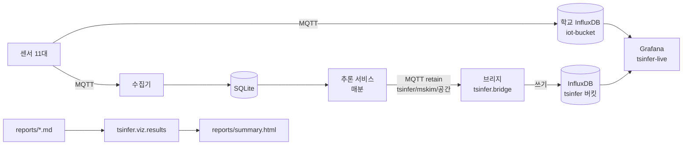

# 실시간 대시보드(Grafana)와 과제 결과 한 페이지

**요약.** 센서 값은 InfluxDB(iot-bucket)에 쌓이지만 추론 결과는 MQTT·API 로만 나가서, 지금까지는 "센서가 지금 어떤지"와 "모델이 뭐라고 했는지"를 한 화면에서 볼 수 없었다. 서비스가 이미 내보내는 MQTT 결과를 InfluxDB 의 별도 버킷에 옮겨 쓰는 작은 브리지를 두고, 두 버킷을 같이 그리는 Grafana 대시보드(패널 20개, Flux)를 만들었다. 과제 2~7 결과는 시계열이 아니라서 Grafana 대신 보고서 표에서 숫자를 읽어 그리는 한 페이지 HTML(`reports/summary.html`)로 만들었다.

| 결과물 | 위치 | 만드는 명령 |
|---|---|---|
| 실시간 대시보드 | [grafana/dashboards/tsinfer-live.json](../grafana/dashboards/tsinfer-live.json) | `python grafana/build_dashboards.py` |
| 추론 결과 → InfluxDB 브리지 | [src/tsinfer/bridge](../src/tsinfer/bridge), [deploy/systemd/tsinfer-bridge.service](../deploy/systemd/tsinfer-bridge.service) | `python -m tsinfer.bridge` |
| Jetson 용 Grafana (학교 Grafana 를 못 쓸 때) | [grafana/docker-compose.yml](../grafana/docker-compose.yml) | `docker compose ... up -d` |
| 과제 결과 한 페이지 | [reports/summary.html](../reports/summary.html) | `python -m tsinfer.viz.results` |

## 구조



## 기술적 판단

**무엇:** 추론 결과를 Grafana 에서 시간 흐름으로 보이게 하기.
**왜 브리지인가 (대안과 버린 이유):**

| 방법 | 장점 | 버린 이유 |
|---|---|---|
| 서비스가 InfluxDB 에 직접 쓰기 | 프로세스 하나 덜 띄움 | 12시간 가동 시험 직전에 서비스 코드를 바꿔야 하고, InfluxDB 장애가 추론 주기를 늦출 수 있다 |
| Grafana MQTT 플러그인으로 바로 구독 | 저장소가 필요 없다 | 지난 값이 남지 않아 '60분 전 예측 vs 실제'를 그릴 수 없고, 학교 Grafana 에 플러그인 설치 권한이 필요하다 |
| Grafana 가 API(:8100/latest) 를 주기 조회 | 설정이 간단 | 마지막 값 하나뿐이라 시계열이 안 된다 |
| **MQTT → InfluxDB 브리지 (채택)** | 서비스·수집기를 건드리지 않음, 브리지가 죽어도 추론은 그대로, 과거 결과가 남는다 | 프로세스 하나(메모리 상한 200MB)와 결과 버킷이 더 필요 |

**어떻게:** 결과 한 건(`docs/interface.md` schema 1.0)을 점 세 종류로 바꾼다 ([points.py](../src/tsinfer/bridge/points.py)).

| measurement | 시각 | 태그 | 필드 |
|---|---|---|---|
| `tsinfer_result` | 추론 시각 | space, model | `data_ok`, `current_*`, `fc_co2_5`~`fc_co2_60`, `fc_temperature_*`, `co2_ventilate_in_minutes`, `occupied`, `ventilation_alert`, `is_anomaly`, `alert_count`, `alert_high_count` |
| `tsinfer_forecast` | 추론 시각 + h분 (예측이 가리키는 시각) | space, model, horizon(5·15·30·60) | `co2`, `temperature` |
| `tsinfer_alert` | 추론 시각 | space, model, type, metric, severity | `value`=1, `detail` |

`tsinfer_forecast` 를 예측이 가리키는 시각에 찍은 것이 핵심이다. 그러면 실제 CO₂ 선과 같은 시간축에 바로 겹쳐지고, Flux `join` 한 번으로 실시간 60분 MAE 를 과제 3 과 같은 방식(현재값 유지와 비교)으로 계산할 수 있다. 판단 불가(null)인 `occupied` 는 0(빈 방)으로 쓰지 않고 비워 둔다.

## 대시보드 패널 (tsinfer-live)

변수: `ds`(InfluxDB 데이터 소스), `bucket`(기본 iot-bucket), `result_bucket`(기본 tsinfer), `space`(공간, 여러 개 선택). 기본 범위 12시간, 1분마다 새로 고침.

| 줄 | 패널 | 보는 것 |
|---|---|---|
| 실시간 센서 | 현재 CO₂ / 온도 / 습도 (stat) | 공간 평균 최신값. CO₂ 1,000ppm 주황, 1,500ppm 빨강 (configs/default.yaml 임계값) |
| | CO₂, 온도, 습도 (시계열) | 공간별 평균, 범례에 최신·최대·평균 |
| | 센서별 마지막 수신 (표) | 장치마다 몇 분 전에 값이 왔는지. 10분 넘으면 주황 (서비스 `data_gap` 기준과 같음) |
| | 수신 건수 5분당 (막대) | 데이터 흐름. 0 이면 수집 끊김 |
| 추론 결과 | 실제 CO₂ vs 30·60분 전 예측 (공간별 반복) | 예측선이 실제선과 얼마나 겹치는지 |
| | 60분 CO₂ 예측 오차 | 서비스 모델 vs 현재값 유지, 범례 mean = 선택 구간 MAE |
| | 60분 뒤 CO₂ 예측 / 1,000ppm 도달까지(분) / 마지막 결과 이후(분) | 지금 알림 상태, 서비스·브리지 멈춤 감지 |
| | 환기 경보 / 이상 경보 / data_ok / 사용 여부 (상태 타임라인) | 경보가 언제 켜지고 꺼졌는지 |
| | 최근 경보 (표) | 경보 종류·항목·심각도·설명 |

## 설치 (Jetson, 복사해서 그대로)

### 0. InfluxDB 에 닿는지와 버전 확인

클라우드 작업 환경에서는 `influx.java21.net` 이 풀리지 않아 Jetson 에서 확인해야 한다.

```bash
curl -sS -m 5 -o /dev/null -D - http://influx.java21.net/ping | grep -i -E "^HTTP|x-influxdb-version"
```

`X-Influxdb-Version: v2.x` 이면 이 대시보드(Flux)를 그대로 쓴다. `1.x` 이면 쿼리를 InfluxQL 로 바꿔야 한다. 응답이 없으면 교육장망 밖에서 막힌 것이다(예전에 10.116.64.13:8086 도 그랬다).

### 1. 결과 버킷과 토큰 (InfluxDB 화면, 한 번만)

InfluxDB 화면에 로그인 → Load Data → Buckets → `tsinfer` 버킷 만들기(보관 30일이면 충분) → API Tokens → Custom API Token 에서 `iot-bucket` 읽기 + `tsinfer` 쓰기만 체크해 만든다. 토큰은 Jetson 의 `.env` 에만 넣는다.

```bash
cd ~/jenson_AIGJ_01_002
nano .env      # 맨 아래에 INFLUX_RESULT_URL, INFLUX_RESULT_ORG, INFLUX_RESULT_BUCKET=tsinfer, INFLUX_WRITE_TOKEN 추가 (기존 INFLUX_* 는 과거 데이터용이라 그대로 둔다)
```

### 2. 브리지

```bash
.venv/bin/python -m tsinfer.bridge --check            # 점 1개를 써 본다. '쓰기 성공' 이면 주소·조직·토큰·버킷이 맞다
.venv/bin/python -m tsinfer.bridge --dry-run          # InfluxDB 에 쓰지 않고 1분 안에 line protocol 이 찍히는지 확인 (Ctrl+C)
cp deploy/systemd/tsinfer-bridge.service ~/.config/systemd/user/
systemctl --user daemon-reload && systemctl --user enable --now tsinfer-bridge
journalctl --user -u tsinfer-bridge -n 20             # "구독: tsinfer/mskim/+ → bucket=tsinfer"
```

브리지는 별도 프로세스라 켜고 꺼도 `tsinfer-collector`, `tsinfer-service` 는 재시작되지 않는다. 12시간 가동 시험(20:00 시작) 전에 켜 두면 시험 구간 전체가 Grafana 에 남는다.

### 3-A. 학교 Grafana 에 가져오기

1. Connections → Data sources → InfluxDB 추가: Query language **Flux**, URL, Organization, Token 입력 → Save & test.
2. Dashboards → New → Import → `grafana/dashboards/tsinfer-live.json` 올리기.
3. 위쪽 InfluxDB 변수에서 1번 데이터 소스를 고른다.

### 3-B. Jetson 에 Grafana 띄우기 (학교 Grafana 를 못 쓸 때)

```bash
# .env 에 GRAFANA_ADMIN_PASSWORD 를 넣은 뒤, 저장소 루트에서
free -h                                                # 공용 보드, 여유 메모리 확인 (컨테이너 상한 300MB)
docker compose --env-file .env -f grafana/docker-compose.yml up -d
# 브라우저: http://<jetson>:8130  (admin / GRAFANA_ADMIN_PASSWORD), 대시보드와 데이터 소스는 자동 등록
```

### 4. 과제 결과 한 페이지

```bash
.venv/bin/python -m tsinfer.viz.results               # reports/summary.html (보고서를 다시 만들면 다시 실행)
```

보고서 표(`reports/*.md`)만 읽으므로 숫자가 보고서와 항상 같다. `logs/service_cycles.jsonl` 이 있으면 과제 8 의 12시간 가동 요약도 판정표에 들어간다. 그림마다 그림 속 숫자를 글로 적은 설명이 붙는다.

## 알림 (디스코드, Grafana Alerting)

**무엇:** 대시보드를 계속 보고 있지 않아도, 과제에서 만든 판단이 디스코드 채널로 온다. 규칙은 `grafana/provisioning/alerting/` 에 파일로 두어 Grafana 를 다시 띄우면 그대로 등록된다.

| 규칙 (`rules.yaml`) | 조건 (1분마다 평가) | 과제 | 메시지 예 |
|---|---|---|---|
| 환기 미리 알림 | 공간별 `tsinfer_result.fc_co2_60` 마지막 값 > 1,000ppm 이 3분 지속 | 3·5 | 🔴 환기 미리 알림 · 실습실: 60분 뒤 CO₂ 예측 1100ppm — 1,000ppm 넘기 전에 환기하세요 |
| 이상 탐지 | 최근 5분에 `tsinfer_alert` severity=high (값 고정·범위 밖·CO₂ 위험, data_gap 제외) | 4 | 🔴 이상 탐지 · 실습실: stuck (co2) |
| 센서 수집 끊김 | `iot-bucket` 공간별 마지막 CO₂·온도가 10분 넘게 전 (서비스 data_gap 기준과 같음) | 1 | 🔴 수집 끊김 · 사무실: 마지막 센서값이 31분 전 |
| 추론 결과 끊김 | 공간별 마지막 `tsinfer_result` 가 5분 넘게 전 (서비스는 매분 냄) | 8 | 🔴 서비스 확인 · 회의실: 마지막 추론 결과가 21분 전 |

조건이 풀리면 ✅ 해제 메시지가 한 번 더 온다. 같은 규칙·공간은 묶어서 보내고, 계속 켜져 있으면 4시간마다 한 번만 다시 보낸다(`policies.yaml`).

**왜 Grafana 알림인가:** 대안은 서비스 코드에서 직접 웹훅을 부르는 것이다. 그러면 12시간 가동 중인 서비스를 고치고 재시작해야 하고, 서비스가 죽으면 "죽었다" 는 알림도 못 보낸다. Grafana 는 서비스 밖에서 InfluxDB 를 보므로 서비스·브리지 멈춤까지 알릴 수 있고, 수집기·서비스·브리지를 건드리지 않는다. 받는 곳(contact point)만 바꾸면 텔레그램으로도 바뀐다(`contact-points.yaml` 주석).

**어떻게:** 웹훅 주소는 Jetson `.env` 의 `DISCORD_WEBHOOK_URL` 에만 두고 `docker-compose.yml` 이 컨테이너 환경변수로 넘긴다. Grafana 는 provisioning 파일의 `${...}` 를 환경변수로 채우므로, 규칙 파일에는 달러 기호를 쓰지 않는다(템플릿은 `index .Labels "space"`).

```bash
# Jetson, 저장소 루트. .env 에 DISCORD_WEBHOOK_URL 을 넣은 뒤 Grafana 만 다시 만든다 (수집기·서비스·브리지는 그대로)
docker compose --env-file .env -f grafana/docker-compose.yml up -d
docker logs grafana-tsinfer-mskim 2>&1 | grep "provision alerting"     # finished to provision alerting
```

확인: Grafana → Alerting → Alert rules 에 `tsinfer` 폴더 규칙 4개, Contact points 에 `tsinfer-notify`.

**실패 → 원인 → 해결:** 첫 시험에서 네 규칙이 모두 `input data must be a wide series but got type long` 오류로 `DatasourceError` 를 보냈다. Flux 결과에 `_start`·`_measurement` 같은 문자 열이 남아 Grafana 가 긴(long) 표로 읽었기 때문이다. 쿼리 끝에 `keep(columns: ["_time", "_value", <태그>])` 를 붙여 해결했고, `tests/test_alerting.py` 가 이를 검사한다.

**실패 → 원인 → 해결 (대시보드):** Jetson 에서 "60분 CO₂ 예측 오차" 패널에 선이 하나도 안 그려지고 범례 Mean·Max 만 나왔다(2026-10-21 14:05~22:25). 실제·예측을 `join` 한 뒤 `map` 으로 새 레코드를 만들면서 `_start`·`_stop` 을 일반 열로 남겼고, Grafana 가 이 고정 시각 열을 시간축으로 써서 모든 점이 한 시각에 몰렸다. `map` 에서 `_time`·`space`·`_value` 만 남겨 고쳤고(같은 모양의 InfluxDB 시험 데이터로 그려지는 것 확인), `tests/test_bridge.py` 가 다시 생기지 않게 검사한다.

## 검증

| 확인 | 방법 | 결과 |
|---|---|---|
| 브리지 변환 | `tests/test_bridge.py`: 서비스 엔진이 실제로 만든 결과로 점 변환, 예측 시각 이동, null 처리, 한글·공백 태그 escape | 통과 |
| 대시보드 ↔ 브리지 이름 일치 | 대시보드 JSON 의 `tsinfer_result` 필드가 모두 브리지가 쓰는 필드인지 검사 | 통과 |
| 요약 숫자 = 보고서 숫자 | `tests/test_viz_results.py`: 과제 3 개선율이 보고서 표와 같은지, 보고서가 없을 때도 페이지가 만들어지는지 | 통과 |
| 실제 InfluxDB·Grafana 에서 쿼리 실행 | Jetson 1호기, 교육장 InfluxDB + Grafana 11.3 (2026-10-21) | 통과. 센서·추론 결과 패널이 모두 그려짐. 사무실 밖은 CO₂ 센서가 없어 예측 패널만 No data |
| 알림 규칙 4개 발화 | Grafana 11.3 + InfluxDB 2.7 컨테이너에 시험 데이터(예측 1,100ppm, 30분 끊긴 센서, 20분 멈춘 결과, stuck 경보)를 넣고 웹훅 수신기로 메시지 확인 (2026-10-21) | 통과. 4개 모두 해당 공간에만 발화, 정상 공간은 Normal. 실제 디스코드 수신은 Jetson 에서 확인 |
| 알림 파일 모양 | `tests/test_alerting.py`: 데이터 소스 uid, wide 표(keep), 브리지 필드 이름, 달러 기호, 라우팅 | 통과 |

## AI 활용

브리지·대시보드 생성 스크립트·요약 페이지의 코드 초안과 이 문서를 Claude Code 로 썼다. 브리지 입력은 손으로 만든 예시가 아니라 서비스 엔진(`Engine.run_once`)이 실제로 만든 결과로 테스트했다. 요약 페이지는 헤드리스 브라우저로 렌더링해 그림과 판정표가 보고서 숫자와 같은지 눈으로 확인했다.

AI 초안에서 잡은 잘못:
- 보고서의 튜플 머리글(`('실습실', 'co2')`)을 pandas `.loc` 로 찾다가 다중 인덱스로 해석돼 `KeyError` 가 났다 → 위치로 찾는 `cell()` 로 바꿨다.
- 그림 설명에 "세 공간 모두 목표 미달", "드리프트·잡음은 못 잡는다" 같은 결론을 문장으로 박아 두었다. 보고서를 다시 만들어 숫자가 바뀌면 틀린 문장이 되므로, 결론 문장도 표에서 계산하게 고쳤다.
- 목표선을 꺾은선으로 그려 공간끼리 이어지는 바람에 없는 추세처럼 보였다 → 범주마다 따로 긋는 가로 표시로 바꿨다.
