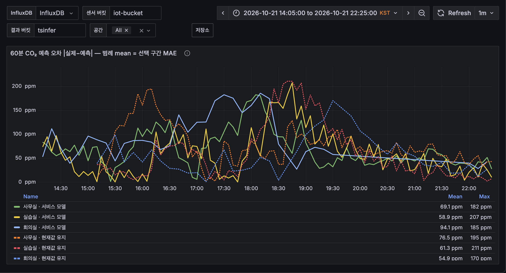

# 교육장 공기질 시계열 추론 — 결과 보고서 (AIP 3.2 개인 과제)

> 작성 규칙: 목차는 과제 안내의 평가 항목 이름(동작 · 성능 · 해석 · 공정한 평가 · 재사용성) 순서다. 숫자에는 근거 파일을 붙이고,
> `⟨…⟩` 칸은 Jetson 실측(`./scripts/run_all.sh`) 결과로 채운다. 그림·표의 내용은 본문에도 한 번 더 글로 적는다.
> 강사님 채점 기준표는 공개되지 않아, 제출 전 추정 루브릭(과제용 A)으로 스스로 채점한다 → [10장](#10-셀프-채점-추정-루브릭-a).

## 0. 요약 (1페이지)

| 구분 | 내용 |
|---|---|
| 문제 | 교육장 CO₂ 가 1,000ppm 을 넘은 뒤에 환기하면 늦다. 센서가 멈추거나 튀어도 사람은 바로 알아채지 못한다. |
| 접근 | MQTT 로 4개 공간 11개 센서를 상시 수집 → 학습과 같은 전처리로 매분 60분 예측·이상 탐지·상태 추정 → API·MQTT 로 발행. 팀 Jetson Orin Nano Super 8GB 에서 메모리 상한을 걸고 상시 운영. |
| 결과 | 60분 CO₂ 오차를 같은 시점의 '현재값 유지'와 비교하면 GRU 가 실습실 40.0→31.8(−20.4%), 사무실 46.4→40.1(−13.6%), 회의실 56.6→52.3(−7.5%) ppm 으로 모든 공간에서 기준선을 이겼지만 목표 −30% 에는 못 미쳤다. TensorRT FP16 은 GRU 배치 1 지연 0.010ms(PyTorch CPU 10.98ms), 변환 오차 최대 0.32ppm 으로 과제 7 기준을 통과했다. 환기 경보는 재현율 0.894 로 기준(0.85)을 넘었지만 macro-F1 은 규칙보다 낮다. 이상 탐지는 헛경보를 1.2회/일에서 0.4회/일로 줄였지만 탐지율이 73.3%에서 65.3%로 내려가 80% 에는 못 미쳤다. 12시간 가동(1회차)은 717/719 주기, 실패 0, 최대 공백 4분(외부 재부팅), 24시간 수집 커버율은 측정 공간 모두 99.3% 이상이다. |
| 의미 | 점수가 좋게 나올 때 오히려 의심해야 했다. 사용 여부 0.965 는 시간표를 외운 점수였고(센서만 쓰면 0.806), 원본 데이터의 헛경보는 센서 고장이 아니라 빈 회의실 온도가 13시간 넘게 그대로인 정상 상태였다. 숫자보다 '그 숫자가 어디서 왔는가'를 먼저 확인해야 한다. |

## 1. 동작

| 확인 기준 | 결과 | 근거 |
|---|---|---|
| 수집기 상시 가동, 끊겨도 자동 재접속 | 2026-10-20 부터 systemd user 서비스로 가동, 재접속 간격 1~30초 | [collector/__main__.py](../src/tsinfer/collector/__main__.py), `systemctl --user status tsinfer-collector` |
| 브로커 재시작 후 1분 안에 재수집 | ⟨네트워크 차단 시험 결과: 끊김 시각, 재수집 시각⟩ | ⟨로그 발췌⟩ |
| 재부팅 후 자동 시작 | 통과. 2026-10-21 15:49 KST 팀원이 보드를 예고 없이 재부팅 → 15:51:46 부팅 → 15:52:01 수집기·서비스 자동 시작(부팅 15초 뒤, 사람 손 없음). 서비스 기록은 15:48 다음이 15:52 로 3주기 공백 | `uptime -s`, `last -x reboot`, `systemctl --user show … -p ActiveEnterTimestamp`, `logs/service_cycles.jsonl`; enable-linger + `WantedBy=default.target` |
| 24시간 커버율 ≥95% | 통과. 10-20 22:27 ~ 10-21 22:27 KST, 10분 칸 기준 실습실 100%, 사무실·회의실·사무실 밖 99.31%, 냉난방 실내기·집중회의실 99.31%. 전체 공백은 1건(10:19~10:29, 10.3분)으로 일부러 낸 수집 중단 시험이다(10분 칸 하나 = 0.69%). 재부팅(15:49~15:52)은 10분 칸을 통째로 비우지 않아 공백으로 잡히지 않았다. '창고'(WS301 문 열림 센서, 24시간 4건, 1.4%)는 상태가 바뀔 때만 보내는 이벤트형 센서라 주기 수집 대상이 아니어서 기준에서 뺐다 | `python -m tsinfer.collector.coverage --hours 24` (10-21 22:27 실행) |
| 서비스 12시간 무중단 | 1회차 2026-10-21 10:15 ~ 22:15 KST (GRU `gru_v1`): 10:28~22:27 KST 구간 717/719 주기(99.7%), 실패 0, 발행 실패 0, 최대 공백 4분(15:49 외부 재부팅, 자동 복귀), 주기당 p95 874ms, 공간별 데이터 끊김 0~1분, 재부팅 뒤 재시작 횟수(NRestarts) 0. 재부팅 공백 때문에 '무중단'으로는 2회차로 다시 확인한다. 2회차(무중단 확인용) 10-21 22:20 ~ 10-22 10:20 ⟨결과⟩ | `python -m tsinfer.service.summary --hours 12` |
| 형식이 바뀌어도 설정만 고친다 | 가정: 펌웨어 갱신으로 CO₂ 키가 `object.co2` → `object.co2_ppm`, 시각이 ISO 문자열 → epoch ms 로 바뀜. 고치기 전에는 CO₂ 가 조용히 빠지고, `configs/sensors.yaml` 두 줄(payload 경로, timestamp 형식)만 바꾸자 코드 수정 없이 다시 저장됐다. 실제로도 냉난방 실내기(xflow, 공간별 dict 형식)를 코드 수정 없이 `each:` 설정으로 추가했다 | [test_format_change_needs_only_config](../tests/test_collector.py), [sensors.yaml](../configs/sensors.yaml) |
| 어떤 시각을 저장하나 | 분석 시각은 센서가 찍은 시각(없으면 수신 시각), 수신 시각은 따로 저장. 네트워크가 30초 밀려 한꺼번에 와도 센서 시각 자리로 들어가고, 같은 (공간, 장치, 항목, 시각)으로 다시 온 재전송은 기본키로 한 번만 저장된다 | [store.py](../src/tsinfer/collector/store.py), `test_store_dedups_retransmission` |
| 수집과 학습·추론의 동시 접근 | SQLite WAL 모드로 수집기가 쓰는 동안 읽기가 막히지 않게 하고, 보고·분석 도구는 읽기 전용(`mode=ro`)으로 연다. 무거운 학습은 InfluxDB 내보내기 파일로 해서 수집 DB 에 부하를 주지 않는다 | [coverage.py](../src/tsinfer/collector/coverage.py) |
| 조회 API 로 공간별 예측·이상·상태 | `GET /latest/{공간}`, `/health`, MQTT `tsinfer/mskim/<공간>`(retain) | [interface.md](interface.md) |
| 수집 10분 중단 → 끊김 경보 → 복귀 | 통과. 수집기 중단 10:19:35 → 끊김 경보 10:29 '사무실 밖', 10:30 사무실·회의실 (`data_ok=false`) → 수집기 재시작 10:29:36 → 10:31 네 공간 모두 정상. 실습실은 센서가 여럿이라 마지막 수신이 늦어 10분 기준에 닿기 전에 복귀했다. | `scripts/outage_test.sh` → `logs/outage_test.log`, `logs/service_cycles.jsonl` |

## 2. 성능

모든 표는 같은 시험 기간(2026-10-06 이후), 같은 시점에서 비교한다.

| 과제 | 확인 기준 | 결과 | 통과 | 근거 |
|---|---|---|---|---|
| 3 예측 | 60분 CO₂ −30%, 온도도 기준선보다 우수 | 실습실 31.8 / 40.0 (−20.4%), 사무실 40.1 / 46.4 (−13.6%), 회의실 52.3 / 56.6 (−7.5%) ppm. 온도는 5·10분에서 현재값 유지와 같음(α=0) | ✗ | [03_forecast](../reports/03_forecast.md) |
| 4 이상 | 탐지율 ≥80%, 헛경보 ≤1회/일 | 1차: 결합 72.0%, 1.2회/일. 2차(잡음 규칙): 73.3%, 1.2회/일 — 원본 경보가 전부 빈 회의실 주말의 온도·습도 '값 고정'으로 밝혀짐. 3차(값 고정 길이·잡음 척도를 정상 기간에서 학습): 65.3%, 0.4회/일 — 헛경보 기준은 통과, 값 고정 탐지가 100%→40% 로 떨어짐 | 3차 ✗ (헛경보 ✓) | [04_anomaly](../reports/04_anomaly.md) |
| 5 상태 | 환기 경보 재현율 ≥85%, 규칙보다 macro-F1↑ | 2차: 환기 재현율 logreg 0.894 · hgb 0.869 (통과), macro-F1 0.59·0.64 < 규칙 0.78 (미달). 사용 여부 센서만 hgb macro-F1 0.806 > 규칙 0.789. 3차 F1 최대 운영점: hgb 0.755(재현율 0.706), logreg 0.736 — 여전히 규칙 0.777 미만 | 재현율 ✓ F1 ✗ | [05_state](../reports/05_state.md) |
| 6 사전학습 | 정확도·구간 적중률·지연·메모리 | 60분 CO₂ MAE Chronos 32.2 / 42.4 / 46.8, GRU 32.2 / 40.6 / 47.2 (실습실/사무실/회의실, 300시점). 10~90% 적중률 77~84%. 배치 1 지연 131ms. 모델 메모리 몫 326MB(프로세스 최고 2,116MB) | – | [06_pretrained](../reports/06_pretrained.md) |
| 7 엣지 | CO₂ 차이 ≤1ppm, 분류 변화 ≤0.1% | TensorRT FP16 최대 0.32ppm, 이상 판정 변화 0%. GRU 지연 배치 1·4: PyTorch CPU 10.98·10.57ms, ONNX 0.119·0.266ms, TensorRT 0.010·0.009ms | ✓ | [07_edge](../reports/07_edge.md) |

## 3. 해석

### 3.1 데이터 진단 (과제 2)
- **정제 규칙:** 물리적으로 불가능한 값은 범위로 지운다(CO₂ 350~5,000ppm, 온도 −10~50℃, 습도 0~100%). 외기가 약 420ppm 이라 350 미만은 센서 오류다. 원본 2,872,162행 중 CO₂ 1,069행, 습도 22행을 지웠다. 결측은 10분 이하만 시간 보간하고, 그보다 긴 결측은 비워 둔다. 긴 구간을 이으면 실제로 없던 값을 학습·평가하게 되기 때문이다. 기록 주기가 다른 센서는 1분 평균으로 맞춘 뒤 같은 공간끼리 평균한다([default.yaml](../configs/default.yaml) `preprocess`, [02_diagnosis](../reports/02_diagnosis.md) 측정 조건).
- **분석 간격 5분:** 10분 주기 센서(회의실 유일 센서, 실습실 2대)가 있어 1분 간격이면 대부분이 빈칸이 되고, 10분이면 60분 예측이 6칸뿐이라 수업 시작 같은 변화를 놓친다. 5분은 10분 주기 센서도 두 칸에 한 번은 들어오고(나머지는 10분 이하 보간), 60분을 12칸으로 볼 수 있는 절충이다.
- **시간순 분할:** 학습 ~9/21, 검증 ~10/6, 시험 이후. 무작위로 섞으면 5분 간격의 바로 옆 칸이 학습과 시험에 나뉘어 들어가, 모델이 미래를 거의 그대로 본 채 채점된다([4장](#4-공정한-평가)).
- **기준선:** 세 공간 모두 모든 지평에서 '현재값 유지'가 가장 강하다(60분 CO₂ 실습실 40.0, 사무실 46.4, 회의실 65.1ppm). CO₂ 는 천천히 변해 60분 뒤에도 지금 값에 가깝기 때문이다. '최근 1시간 평균'은 오르는 중에는 늘 뒤처진다(60분 51~84ppm). '어제 같은 시각'은 지평과 관계없이 100~190ppm 으로 가장 나쁘다. 월요일의 '어제'는 빈 일요일이고, 수업·회의 시작 시각과 인원이 날마다 달라서다. 매일 같은 시각에 같은 인원이 쓰는 공간(예: 고정 시간표 강의실)이라면 이 방법이 강해질 것이다([02_baselines](../reports/02_baselines.md)).
- **센서 기록 주기가 섞여 있다:** 실습실에는 1~2분마다 기록하는 센서와 10분마다 기록하는 센서(`…c140101` CO₂·온습도, `…d151523` 온습도)가 섞여 있고, 회의실은 10분 주기 센서 한 대뿐이다([02_diagnosis](../reports/02_diagnosis.md) 1장). 5분 칸으로 평균하면 실습실은 칸마다 들어가는 센서 수가 번갈아 바뀐다. 실습실 온도의 현재값 유지 오차가 30분(0.08℃)보다 15분(0.12℃)에서 더 큰 것은 이 10분 주기 흔들림 때문으로 본다(30분은 10분의 배수라 같은 센서 구성끼리 비교된다). 이것은 추정이고, 10분 주기 센서를 빼고 다시 재 보면 확인할 수 있다.
- **결측:** 회의실은 5분 칸 기준 결측 50.5%(보간 후 0.7%)인데, 고장이 아니라 10분 주기 센서 한 대라 칸 하나 걸러 비기 때문이다. 1시간 이상 이어진 결측은 '사무실 밖' CO₂ 하나뿐이고, 그 장치에는 원래 CO₂ 센서가 없다.
- **평일 패턴:** 평일 CO₂ 는 세 공간 모두 9시부터 오르기 시작해 점심(12시)에 잠깐 내려갔다가 오후에 다시 올라 정점에 이른다. 정점은 실습실 17시 1,487ppm, 사무실 17시 1,168ppm, 회의실 15시 1,857ppm 이다. 회의실은 평일 평균으로도 10~18시 내내 1,000ppm 을 넘는다. 주말에는 세 공간 모두 500~780ppm 에 머문다([02_diagnosis](../reports/02_diagnosis.md) 3장, [그림](../reports/figures/02_co2_hourly.png)).
- **CO₂ 반응 시간:** 상승 시작부터 정점까지 중앙값 실습실·사무실 170분, 회의실 130분이고, 정점 뒤 절반 회복은 60~65분이다. 사람이 들어온 뒤 2시간 넘게 오르므로, 60분 예측과 30분 전 경보는 상승 구간 안에서 충분히 의미가 있다. 회의실은 한 번 오를 때 중앙값 922ppm 이 올라 다른 공간(382~414ppm)의 두 배가 넘는다.

### 3.2 예측 (과제 3)
- **무엇:** 5~60분 CO₂·온도 예측. **왜:** 1,000ppm 을 넘기 전에 환기 경보를 내려면 미리 알아야 한다.
- **어떻게:** 최근 2시간 입력, 지금 대비 변화량을 12칸 한 번에 출력, 공간 전체로 하나의 GRU. 현재값 유지가 가장 강한 기준선이라 그 위의 변화만 배우게 했다(절대값 예측은 버림).
- **결과:** 같은 시험 시점에서 60분 CO₂ 오차가 실습실 31.8(현재값 유지 40.0, −20.4%), 사무실 40.1(46.4, −13.6%), 회의실 52.3(56.6, −7.5%) ppm 이다. 모든 공간에서 기준선은 이겼지만 목표 −30% 에는 못 미쳤다. 온도는 검증에서 5·10분 보정 계수 α 가 0 으로 정해져 현재값 유지와 같아졌고, 그래서 '모든 지평에서 우수' 조건도 통과하지 못했다. 시각·요일 입력을 빼면 60분 CO₂ 오차가 실습실 +2.2, 사무실 +3.9, 회의실 +1.9 ppm 커졌다. 일정 입력(평일 9~18시)을 빼면 실습실 +10.3, 회의실 +1.9 ppm 커졌고 사무실은 −0.5ppm 으로 차이가 없었다. 각 비교는 시드 하나로 학습한 결과라, 2ppm 안팎의 차이는 학습 때마다 달라질 수 있는 크기다 ⟨시드 반복으로 확인 예정⟩.
- **공간별 차이:** 회의실 개선 폭이 가장 작다. 회의실은 한 번에 922ppm 씩 오르고(다른 공간의 두 배), 10분 주기 센서 한 대라 입력 정보도 가장 적다. 회의 시작·종료가 매일 같은 시각이 아니어서 시각·요일·일정 입력으로 미리 알 수 없는 부분이 크다고 본다.
- **실제 가동 중 오차 (Grafana):** 10-21 14:05~22:25 KST 실시간 60분 CO₂ 오차(MAE)는 사무실 69.1(현재값 유지 76.5), 실습실 58.9(61.3)로 시험 기간처럼 모델이 앞섰다. 회의실은 94.1(54.9)로 시험 기간(52.3 대 56.6)과 반대로 모델이 뒤졌다. 이 회의실 숫자는 그대로 믿기 어렵다. 17~18시에 회의실 선만 혼자 크게 튀었고, 19:30 이후에는 회의실 점이 드문드문 들어와 선이 거의 직선으로 이어 그려졌다. 또 이 구간은 회의실 예측이 빈 값으로 나오던 버그(PR #39, 22:28 재시작부터 반영)를 고치기 전이라, 모델과 현재값 유지가 같은 시점끼리 비교되지 않았을 수 있다. 학습 때 없던 회의실 장치가 새로 데이터를 보내 입력 평균이 달라졌을 가능성도 확인 중이다 ⟨장치별 확인 결과⟩. 실시간 오차가 시험 기간보다 큰 것은 시험 기간에는 값이 거의 안 변하는 밤·주말이 섞여 평균이 낮아지는 반면, 이 구간은 사람이 드나드는 오후가 대부분이고 8시간뿐이기 때문으로 본다(추정). 그래서 성능 판정은 시험 기간 숫자로 하고, 이 숫자는 실제로 돌면서도 사무실·실습실에서 기준선을 이긴다는 근거로만 쓴다.

  

### 3.3 이상 탐지 (과제 4)
- **무엇:** 센서 고장 5종(급변, 값 고정, 드리프트, 잡음, 끊김)을 사람이 알아채기 전에 표시한다. 실데이터에는 고장 정답이 없어 시험 기간에 고장을 직접 넣어 채점했다. 과제 안내의 5종(튄 값, 값 고정, 영점 틀어짐, 냉방 정지, 환기 정지) 가운데 냉방 정지·환기 정지는 1~3차 시험에 없었고, 심화 시험에서 따로 넣어 잰다([3.8](#38-심화b-결과)).
- **왜 규칙 + 오토인코더:** 값 고정·끊김·급변은 정의가 분명해 규칙이 확실하고 설명하기 쉽다. 드리프트·잡음은 '평소와 다른 모양'이라 규칙 임계값을 정하기 어려워 정상 데이터로만 학습하는 오토인코더가 맞다. 한쪽만 쓰면 규칙은 드리프트를, 오토인코더는 짧은 끊김을 놓친다(버린 대안: 한쪽만 사용, 고장 라벨로 지도학습 — 실제 고장 라벨이 없다).
- **어떻게:** 1시간(12칸) × 3항목 × (값, 5분 변화량) 창, 72→32→8→32→72 구조. 임계값은 정상(검증) 기간 경보가 하루 0.5회 이하인 가장 낮은 값으로 정해, 확인 기준(하루 1회)보다 여유를 뒀다. [anomaly.py](../src/tsinfer/models/anomaly.py)
- **결과 (1차):** 규칙은 급변·값 고정·끊김을 100% 잡았지만 드리프트 20%, 잡음 6.7% 만 잡았다. 오토인코더는 급변 100%, 잡음 33%, 드리프트 13% 였고 값 고정과 끊김은 0% 였다. 둘을 합치면 72.0% 에 헛경보 1.2회/일로 두 기준 모두 미달했다. 고장을 넣지 않은 원본 시험 기간에서도 규칙이 1.35회/일 경보를 냈는데, 이것이 진짜 이상(실제 수집 끊김 등)인지 헛경보인지는 1차 보고서로 가릴 수 없었다. 오토인코더 임계값을 0.95 분위수로 낮추면 하루 0.64회에서 58.7%, 0.9 분위수면 2.62회에서 64% 로, 오토인코더만으로는 80% 에 닿지 않는다([그림](../reports/figures/04_threshold.png)).
- **2차 보강:** 잡음을 잡는 규칙(최근 1시간 5분 변화량의 표준편차가 정상 기간 최고 수준을 넘으면 경보)을 추가했다. 임계값은 학습·검증 기간에서만 정해 시험 기간을 보지 않는다. 원본 경보가 어느 규칙에서 나왔는지 집계표와 사건 목록도 보고서에 넣었다. 결과(2차): 잡음 탐지가 규칙 6.7%→33.3%, 결합 72.0%→73.3% 로 조금만 올랐다. 1시간 5분 변화량으로 재면 사람이 들어올 때 CO₂ 가 꾸준히 오르는 것도 '흔들림'으로 잡혀 정상 기간 임계값이 너무 높게 정해졌기 때문이다. 원본 경보 1.35회/일은 원인표로 보니 전부 '값 고정'이었다(온도 0.92회/일, 습도 0.43회/일). 사건 목록을 보면 대부분 회의실의 10/10~10/13(주말 포함)이다. 회의실은 10분 주기 센서 한 대라 0.1℃ 분해능 안에서 빈 방 온도가 몇 시간씩 그대로 머문다. 센서 고장이 아니라 고정 판정 길이(3시간)가 이 방에는 짧은 것이다.
- **3차 보강:** 잡음은 2차 차분(변화량의 변화량)의 흔들림으로 재서 꾸준한 상승은 잡음으로 치지 않게 했다. 값 고정 판정 길이는 공간·항목별로 정상 기간에 같은 값이 실제로 이어진 길이(99.9% 분위수)보다 길 때만 경보하도록 정상 기간에서 정한다. 대신 빈 방이 오래 조용한 공간에서는 3시간짜리 진짜 고정을 놓칠 수 있다. 결과(3차): 원본 시험 기간 경보가 1.35회/일(규칙)에서 0.14회/일로, 고장 주입 시험의 결합 헛경보가 1.2회/일에서 0.4회/일로 줄어 헛경보 기준(≤1회/일)을 통과했다. 잡음 탐지는 규칙 33.3%→66.7%, 결합 73.3% 로 올랐다. 대신 값 고정 탐지가 100%→40% 로 떨어져 결합 탐지율은 73.3%→65.3% 로 내려갔다. 정상 기간에서 배운 고정 길이가 회의실 온도 830분, 습도 510분, 사무실 온도 290분으로 주입한 고장(180분)보다 길어, 이 칸들에서는 3시간 고정이 정상과 구별되지 않는다. 드리프트(6시간에 걸친 천천히 어긋남)는 규칙 6.7%, 결합 13.3% 로 세 번 모두 가장 약했다. 남은 원본 경보 5건은 회의실 10분 결측 1건, 회의실 CO₂ 오토인코더 1건, 사무실 습도 3건(값 고정 1, 오토인코더 2)이다.
- **해석 (초안):** 규칙은 정의가 분명한 고장(급변·끊김 100%)에 강하고, 오토인코더는 급변 외에는 약했다. 오토인코더를 더해 얻는 것은 드리프트 +6.7%p, 잡음 +6.6%p 정도이고 헛경보는 0.14→0.4회/일로 늘었다. 80% 에 못 미친 핵심은 두 가지다. 값 고정은 센서 분해능(0.1℃)과 10분 주기 때문에 빈 방의 정상 상태와 구별이 안 되고, 드리프트는 1시간 창으로는 보이지 않는다. 1차~3차는 결국 '헛경보 1.2회 / 탐지 73%'와 '헛경보 0.4회 / 탐지 65%' 사이에서 고르는 문제였다.
- **운영 제안 (초안):** 서비스에는 3차 설정(학습한 고정 길이, 2차 차분 잡음, 오토인코더 임계값 1.527)을 그대로 쓴다. 급변·끊김 경보는 바로 담당자에게, 값 고정·잡음·오토인코더 경보는 하루 한 번 모아 확인하는 목록으로 보낸다. 다음 단계로 같은 공간 다른 센서와의 차이(실습실은 센서가 여럿)나 예측 오차 누적으로 드리프트를 잡고, CO₂ 가 움직이는데 온도만 멈춘 경우처럼 항목 사이를 함께 보는 값 고정 규칙을 시험한다.

### 3.4 상태 추정 (과제 5)
- **무엇:** 공간 사용 여부와 '30분 안에 CO₂ 1,000ppm 초과'(환기 경보)를 분류한다.
- **왜 두 분류기:** 로지스틱 회귀는 계수로 이유를 설명할 수 있고, HistGradientBoosting 은 '시각 × 최근 변화량' 같은 상호작용을 잡는다. 둘 다 불균형을 class_weight=balanced 로 보정. 비교 기준은 현장에서 쓰던 규칙(CO₂ 임계값)이다.
- **어떻게:** 환기 경보 임계값은 검증 기간 재현율 ≥85% 인 가장 높은 확률값으로 정했다. 놓치는 것(환기 안 함)이 헛경보보다 비싸서다. 사용 여부 정답(시간표)은 입력에서 뺐다. [state.py](../src/tsinfer/models/state.py)
- **결과 (1차):** 사용 여부는 hgb macro-F1 0.965, 빈방을 사용 중으로 본 비율 0.1% 로 규칙(0.789)보다 훨씬 좋게 나왔다. 그런데 정답이 시간표(평일 9~18시)라 시각·요일만 알아도 맞힐 수 있다. 입력에 시각·요일이 들어 있어 모델이 센서가 아니라 시간표를 외운 점수라고 판단했다. 환기 경보는 재현율 logreg 0.80·hgb 0.79 로 목표 0.85 에 못 미쳤고, macro-F1(0.68·0.67)도 규칙(0.78)보다 낮았다.
- **2차 보강:** 사용 여부는 센서 특성만으로 학습하고, 시각을 넣은 모델은 '참고' 행으로만 남겨 차이를 보인다. 환기 경보 임계값은 검증 기간만으로 정하면 연휴 때문에 양성이 적어 흔들리므로, 학습+검증 기간을 시간순 5구간으로 나눈 교차 예측에서 정하고 최종 모델은 학습+검증으로 다시 학습한다. 결과(2차): 사용 여부는 센서만 쓰면 hgb macro-F1 0.806, logreg 0.796 으로 규칙(0.789)을 조금 넘는다. 같은 hgb 에 시각·요일을 넣으면 0.965 가 되므로, 1차 점수의 대부분은 시간표를 외운 몫이었다. 환기 경보 임계값을 교차 예측으로 정하자 재현율이 logreg 0.894, hgb 0.869 로 기준 0.85 를 넘었다. 대신 정밀도가 0.13~0.19 로 떨어져 macro-F1(0.59·0.64)은 규칙(0.78)보다 낮다. 규칙은 재현율 0.575 에서 정밀도 0.548 이라, 두 기준(재현율 ≥85%, 규칙보다 macro-F1↑)이 서로 당기고 있다. 그래서 같은 모델의 'macro-F1 최대' 운영점도 함께 쟀다. 결과(3차): hgb 는 임계값 0.877 에서 macro-F1 0.755(재현율 0.706, 정밀도 0.411), logreg 는 0.959 에서 0.736 으로, 운영점을 옮겨도 규칙(0.777)을 넘지 못했다. 규칙보다 재현율이 높은 운영점(hgb 0.706 vs 0.575)에서 F1 은 비슷하므로, 30분 앞 경보에 쓰는 신호(CO₂ 변화량, 최근 최고값)가 이미 규칙과 같은 정보이고 모델이 더할 것이 크지 않다고 본다. 헛경보는 실습실 9·10·13시, CO₂ 750~950ppm 에서 15분에 25~75ppm 씩 오르던 때에 몰렸다. 오르다 1,000ppm 직전에 멈추는 수업 시작·점심 직후 패턴이다.
- **해석 (초안):** 사용 여부는 센서만으로 규칙을 조금 넘는 정도(0.806 vs 0.789)이고, 놓친 시점은 9시·회의실 오전(CO₂ 570ppm 안팎, 아직 오르기 전)과 실습실 16~17시(CO₂ 830ppm 에서 정체)에 몰렸다. 사람이 막 들어왔거나 창문을 연 채 수업 중이면 CO₂ 만으로는 알 수 없다. 18시 회의실·사무실 헛경보(CO₂ 1,190~1,260ppm, 떨어지는 중)는 사람이 나간 직후 CO₂ 가 남아 있는 경우다. 서비스에서는 놓침을 줄이는 쪽이 중요하므로 환기 경보는 재현율 운영점(hgb 0.253)을 쓰고, 헛경보가 부담스러운 화면 알림에는 F1 운영점(0.877)을 쓴다.
- **가장 많이 틀린 상황 (1차):** 사용 여부는 9시·17시, 곧 시간표 경계에서 놓친 경우가 가장 많았다. 회의실은 10~16시 내내 CO₂ 가 550~570ppm 으로 평평한데 정답이 '사용 중'인 시점을 놓쳤다. 실제로 비어 있던 날이라 정답(가정)이 틀렸을 가능성이 크다. 환기 경보의 헛경보는 실습실 9·10·13시에 몰렸고, 이때 CO₂ 는 760~950ppm 에서 15분에 30~75ppm 씩 오르고 있었다. 오르다가 1,000ppm 직전에 멈춘 경우다.

### 3.5 사전학습 모델 채택 의견 (과제 6)
- **무엇:** 우리 데이터로 학습하지 않은 Chronos-Bolt(small)를 그대로(zero-shot) 써서 GRU 와 같은 시점에서 비교한다.
- **왜:** 학습 데이터가 3개월뿐이라, 대량 시계열로 미리 학습한 모델이 더 나을 수 있는지와 그 대가(지연·메모리)를 확인하려고. 10~90% 구간을 함께 주므로 '얼마나 확실한지'도 비교할 수 있다.
- **결과:** 같은 300개 시점에서 60분 CO₂ MAE 가 Chronos 실습실 32.2 · 사무실 42.4 · 회의실 46.8, GRU 32.2 · 40.6 · 47.2, 현재값 유지 40.1 · 48.7 · 51.3 ppm 이다. 우리 데이터로 학습하지 않은 Chronos 가 60분에서 GRU 와 거의 같다. 실습실 CO₂(5분 10.6 vs GRU 11.5ppm)와 세 공간 온도(예: 실습실 5분 0.05 vs 0.11℃)는 Chronos 가 더 낫고, 사무실·회의실의 5분 CO₂ 는 GRU 가 낫다. 10~90% 구간 적중률은 77~84% 로 기대값 80% 에 가깝다. 배치 1 지연은 CPU 에서 131ms(p95 180ms) 로 GRU(ONNX 0.12ms) 보다 1,000배 느리지만, 매분 한 번 추론하는 서비스에는 충분하다. 메모리는 1차 측정이 데이터 적재 때의 최고치(2,128MB)를 그대로 보고해 모델 몫을 알 수 없었다. 적재 전후 현재 RSS 차이로 다시 재니 모델 몫은 326MB 다. 다음 주 로컬 LLM 과 같은 8GB 보드에 함께 올리는 데 큰 부담은 아니다.
- **채택 의견 (초안):** 지금 서비스의 기본 예측은 GRU(ONNX)로 두고, Chronos 는 '얼마나 확실한지' 구간이 필요한 화면이나 학습 데이터가 없는 새 공간의 첫 예측에 보조로 쓴다. 60분 정확도는 거의 같고 지연은 1,000배 크지만 매분 한 번이면 문제없으며, 모델 몫 326MB 는 8GB 보드에서 로컬 LLM 과 함께 올릴 수 있는 크기다. 다만 프로세스 최고 2.1GB 는 데이터 적재 때문이므로, 함께 올릴 때는 적재 방식을 줄여야 한다.

### 3.6 엣지 최적화 (과제 7)
- **무엇:** GRU·오토인코더를 ONNX 로 바꾸고 TensorRT FP16 엔진으로 만들어 지연과 변환 오차를 잰다.
- **왜:** 서비스는 매분 돌아 지금도 충분히 빠르지만, 같은 보드에 카메라·LLM 이 함께 올라갈 대회 시스템에서는 CPU·메모리를 아껴야 한다. FP16 은 숫자 정밀도를 낮추므로 '판정이 바뀌지 않는가'를 함께 확인해야 한다(버린 대안: INT8 — 보정 데이터가 필요하고 오차 위험이 커서 이번엔 제외).
- **어떻게:** ONNX opset 17 → onnxruntime CPU / trtexec `--fp16`, 같은 입력으로 출력 비교, 측정 중 tegrastats 기록. [edge.py](../src/tsinfer/models/edge.py)
- **결과:** GRU 배치 1 지연은 PyTorch CPU 10.98ms, ONNX Runtime CPU 0.119ms, TensorRT FP16 0.010ms 다. 변환 후 CO₂ 최대 차이는 ONNX 0.0001ppm, TensorRT FP16 0.32ppm 이고, 오토인코더 이상 판정은 8,192개 창에서 하나도 바뀌지 않았다. 과제 7 기준(≤1ppm, ≤0.1%)을 모두 통과했다. 측정 중 GPU 평균 사용률 3.4%, 전력 평균 7.4W(최대 8.7W) 였다. 같은 CPU 인데 ONNX 가 PyTorch 보다 90배 빠른 것은 PyTorch 가 작은 입력 한 번마다 연산 준비 비용을 크게 치르기 때문으로 본다. 매분 3개 공간을 추론하는 서비스에는 ONNX CPU 로도 충분하므로, GPU 는 대회 때 카메라·LLM 몫으로 남겨 두는 편이 낫다. PyTorch GPU 는 Jetson 용 CUDA torch 가 설치되지 않아 측정하지 못했다.

### 3.7 가장 의외였던 발견 (발표용)
- **(초안)** 가장 의외였던 것은 좋은 점수가 오히려 틀린 신호였다는 점이다. 사용 여부 분류기가 처음에 macro-F1 0.965 를 냈는데, 정답을 시간표로 만들고 입력에 시각을 넣었기 때문에 모델은 CO₂ 가 아니라 '지금이 평일 9~18시인가'를 외우고 있었다. 시각을 빼자 0.806 으로, 규칙(0.789)보다 겨우 조금 나은 수준이 됐다. 이상 탐지에서도 비슷했다. 원본 데이터에서 하루 1.35회 울리던 '고장' 경보는 전부 빈 회의실 온도가 0.1℃ 분해능 안에서 몇 시간씩(정상 기간 최장 830분) 그대로인 정상 상태였다. 두 경우 모두 모델을 고치기 전에 '이 숫자가 어디서 왔는지'를 먼저 확인했어야 했다.

### 3.8 심화(B) 결과
10-21 밤 `./scripts/run_all.sh deep` 실행 결과로 채운다. 모든 심화 보고서는 기본 결과와 같은 시험 기간·시점을 쓰고, 임계값·가중치·조합은 검증 기간에서만 고른다.

| 과제 | 심화 항목 | 결과 | 근거 |
|---|---|---|---|
| 1 | 1년 저장 용량과 보관 정책, 재전송 건수 | ⟨1년 뒤 크기, 정책별 크기, 재전송 흔적⟩ | [01b_storage](../reports/01b_storage.md) |
| 3 | GRU·LSTM·TCN × 과거 1·2·4시간, 한 공간 빼고 학습 | ⟨최적 조합, 처음 보는 공간 오차⟩ | [03b_forecast_deep](../reports/03b_forecast_deep.md) |
| 4 | 예측 오차 탐지기 vs 오토인코더, 영점 틀어짐 전용 탐지, 냉방·환기 정지 | ⟨드리프트 탐지율·지연, 결합 탐지율·헛경보⟩ | [04b_anomaly_deep](../reports/04b_anomaly_deep.md) |
| 5 | 한 공간 빼고 사용 여부, 시간표와 추정 사용 대조 | ⟨새 공간 macro-F1 하락, 수업인데 빈 시간⟩ | [05b_state_deep](../reports/05b_state_deep.md) |
| 6 | GRU + Chronos 앙상블, 공변량 모델 | ⟨앙상블 MAE, 둘 다보다 나은 칸 수⟩ | [06b_pretrained_deep](../reports/06b_pretrained_deep.md) |
| 7 | INT8, 모델 4개 동시 메모리와 로컬 LLM 조합 | ⟨INT8 지연·오차, 남는 메모리⟩ | [07b_edge_deep](../reports/07b_edge_deep.md) |
| 8 | 예측 기반 환기 제어 시뮬레이션, 60분 뒤 자기 채점·알림 | ⟨1,000ppm 초과 시간 감소율, 자기 채점 MAE⟩ | [08b_control](../reports/08b_control.md), `/health` `monitor` |

- 회의실 노쇼·예약 없는 사용(과제 5 심화)은 회의실 예약표와 직접 관찰 기록이 없어 하지 못했다. 같은 방법을 실습실 수업 시간표에 적용한 대조로 대신했다.

## 4. 공정한 평가

| 원칙 | 적용 | 근거 |
|---|---|---|
| 미래를 엿보지 않는다 | 학습 ~2026-09-21, 검증 ~10-06, 시험 이후로 시간순 분할. 무작위 섞기 없음 | [split.py](../src/tsinfer/data/split.py), [default.yaml](../configs/default.yaml) |
| 정규화는 학습 기간 통계만 | 평균·표준편차·변화량 척도 모두 학습 기간에서 계산 | `fit_scaler`, `forecast.fit_spec` |
| 같은 시점·같은 조건 비교 | 모든 방법이 값을 낸 시점에서만 채점, 기준선 표와 모델 표가 같은 시점 | `baselines.evaluate`, `forecast.score`, `pretrained.compare` |
| 검증 기간 편향 제거 | 검증 기간에 추석·개천절 연휴가 몰려 있어 모델 선택은 일하는 날 창으로만 | [6장](#6-실패와-해결) |
| 정답이 입력에 새지 않는다 | 사용 여부 정답이 시간표(시각·요일의 함수)라, 사용 여부 분류기 입력에서 시각·요일까지 뺐다(1차에서 이걸 놓쳐 점수가 부풀었다 → [6.4](#64-사용-여부-점수가-시간표를-외운-점수였다-과제-5)). 환기 경보 양성은 '이미 넘은 시점' 제외 | [state.py](../src/tsinfer/models/state.py) |
| 목표도 같은 시점으로 | 과제 3 목표(−30%)는 과제 2 표(회의실 65.1)가 아니라 GRU 와 같은 시험 시점의 현재값 유지(회의실 56.6)를 기준으로 계산. 과제 2 표는 창을 만들 수 없는 시점까지 포함해 값이 다르다 | [03_forecast](../reports/03_forecast.md) 목표 확인 표 |
| 고장 시험에 정답이 있다 | 시험 기간에 고장 5종을 정해진 규칙으로 주입, seed 고정, 고장 사이 6시간 | [anomaly.py](../src/tsinfer/models/anomaly.py) |
| 측정 조건 명시 | 모든 보고서 첫머리: 데이터 기간, 실데이터 여부, 시험 기간, 전력 모드, 반복·워밍업 | [reports/](../reports) |

## 5. 재사용성

- **설정만 바꾸면 된다:** 센서 형식 변경은 `configs/sensors.yaml`, 공간·임계값·공휴일은 `configs/default.yaml`, 정답 시간표는 `configs/schedule.yaml`.
- **학습과 서비스가 같은 코드:** 전처리 `preprocess.clean/to_wide`, 입력 `forecast.make_windows` 를 서비스도 그대로 쓴다. 모델 파일에 정규화 통계·공휴일·일정·보정 계수를 함께 저장한다.
- **다른 사람이 문서만 보고 사용:** 2026-10-21 20:18 KST 팀원(본인 계정 `seongchan`)이 [interface.md](interface.md) 만 보고 Jetson 에서 `curl -s localhost:8100/latest` 를 호출해 네 공간의 현재값·60분 예측·이상·상태를 받았다. 처음에는 본인 맥북에서 쳐서 응답이 없었는데, `localhost` 가 Jetson 이 아니라 맥북을 가리켰기 때문이다. 문서에 '보드 안에서 또는 보드 주소로' 호출한다는 안내를 더했다.
- **모델 교체:** `.env` 의 `SERVICE_MODEL` 만 바꾸면 된다. 모델 파일이 없으면 기준선으로 계속 돈다.
- **검증:** pytest 104개 (합성 데이터로 수집 매핑·형식 변경, 전처리, 기준선, 예측, 이상 탐지, 상태 추정, ONNX 변환, 서비스 API, 심화 모듈).
- **재현:** `./scripts/run_all.sh` 한 번으로 과제 2~7 보고서, `./scripts/run_all.sh deep` 으로 심화 보고서 생성. 결과 형식은 [interface.md](interface.md).

## 6. 실패와 해결

### 6.1 GRU 가 현재값 유지보다 나빴다 (과제 3)
- **문제:** 1차 학습에서 60분 CO₂ 오차가 실습실 44.5, 사무실 46.4, 회의실 76.9 ppm 으로 같은 시점 현재값 유지(40.0, 46.4, 56.6)보다 나빴다. 회의실은 5분 오차부터 15.6 vs 10.4 ppm 으로 나빴다.
- **원인:** 검증 손실이 1번째 에폭에서 가장 낮고 학습 손실(0.131)보다 3배 이상 낮았다(0.037). 검증 기간(9/21~10/6)에 추석 연휴(9/24~26)와 개천절·대체공휴일(10/3, 10/5)이 몰려 방이 거의 비어 있었고, 조기 종료가 사실상 학습 전 모델을 골랐다. 또 '평일 여부' 입력이 공휴일을 평일로 보고 있었다.
- **해결:** 공휴일을 설정에 넣어 평일 여부에서 제외, 조기 종료는 검증 기간의 일하는 날 창으로만, 손실을 평가 지표와 같은 L1 로, 지평별 보정 계수 α(0=현재값 유지, 1=모델)를 검증에서 정해 최소한 기준선만큼은 나오게 했다. 결과: 60분 CO₂ 오차가 실습실 44.5→31.8, 사무실 46.4→40.1, 회의실 76.9→52.3 ppm 으로 세 공간 모두 기준선보다 나아졌다. 학습도 16에폭까지 진행되며 검증 손실이 10번째 에폭에서 가장 낮았다(1차는 1번째).
- **재발 방지:** 검증·시험 기간을 정할 때 공휴일 목록을 먼저 확인하고, 학습 곡선에서 검증 손실이 학습 손실보다 훨씬 낮으면 기간 편향부터 의심한다.
- **근거:** 1차 수치는 2026-10-20 Jetson 실행 출력(보고서 파일은 개선판으로 덮어써져 저장소에는 개선판만 있음), 개선판은 [03_forecast](../reports/03_forecast.md), 수정은 [PR #12](https://github.com/AIP-1-3/jenson_AIGJ_01_002/pull/12).

### 6.2 값 고정 고장을 절반만 잡았다 (과제 4)
- **문제:** 합성 시험에서 3시간 같은 값을 넣었는데 값 고정 규칙 탐지율이 50%였다.
- **원인:** pandas rolling 표준편차는 긴 시계열에서 부동소수 누적 오차로 정확히 0 이 나오지 않는다.
- **해결:** '구간 최대 − 최소 == 0' 으로 판정을 바꿨다.
- **재발 방지:** 같은 값 판정에는 분산 계산을 쓰지 않는다. 값 고정 주입 시험을 테스트로 남겨 다시 깨지면 바로 보이게 했다.
- **근거:** [tests/test_anomaly.py](../tests/test_anomaly.py), [PR #8](https://github.com/AIP-1-3/jenson_AIGJ_01_002/pull/8).

### 6.3 Jetson 에서 parquet 를 못 읽었다 (환경)
- **문제:** 과거 데이터 내보내기 후 parquet 를 읽을 때 `ImportError: Unable to find a usable engine; tried using: 'pyarrow', 'fastparquet'.` 가 났고, venv 에 pyarrow 를 설치하자 `pyarrow requires NumPy 2.0 or newer, found 1.26.4` 로 다시 실패했다.
- **원인:** 시스템 pandas 가 venv 의 pyarrow 를 보지 못했고, 새로 받은 pyarrow 26.0.0 은 NumPy 2 를 요구해 JetPack 의 OpenCV·TensorRT(NumPy 1.26 기준)와 맞지 않았다.
- **해결:** venv 에 pandas 와 `pyarrow<20` 을 설치하고 `numpy<2` 를 requirements 에 고정.
- **재발 방지:** 이후 모든 설치 명령에 `"numpy<2"` 를 함께 적는다(README 설치 절). [requirements.txt](../requirements.txt), [PR #4](https://github.com/AIP-1-3/jenson_AIGJ_01_002/pull/4).

### 6.4 사용 여부 점수가 시간표를 외운 점수였다 (과제 5)
- **문제:** 1차에서 사용 여부 macro-F1 이 hgb 0.965, 빈방을 사용 중으로 본 비율 0.1% 로 지나치게 좋게 나왔다.
- **원인:** 정답은 시간표(평일 9~18시)로 만들었는데, 입력에 시각(sin/cos)과 평일 여부가 들어 있었다. 모델이 CO₂ 가 아니라 '지금이 평일 9~18시인가'를 배웠다. 놓친 사례가 9시·17시 경계에 몰리고, 회의실처럼 CO₂ 가 평평한 날도 '사용 중'으로 맞힌 것이 그 흔적이다.
- **해결:** 사용 여부 분류기는 센서 특성만 쓰고, 시각을 넣은 모델은 '참고' 행으로만 남겨 차이를 보인다. 결과: 센서만 hgb macro-F1 0.806(규칙 0.789), 시각 포함 0.965. 0.16 차이가 시간표를 외운 몫이다.
- **재발 방지:** 정답을 만들 때 쓴 정보(시각·달력)가 입력에 있는지 먼저 확인한다. 점수가 기대보다 크게 좋으면 누출부터 의심한다.
- **근거:** 1차 [05_state](../reports/05_state.md) (커밋 f0a65fe), 수정 PR #17.

### 6.5 서비스가 하루 가까이 죽었다 살아나기를 반복했다 (과제 8)
- **문제:** 12시간 시험을 시작하려고 `curl localhost:8100/health` 를 쳤는데 아무 응답이 없었다. `systemctl --user is-active tsinfer-service` 는 `active` 였다. 로그에는 `AttributeError: 'FastAPI' object has no attribute 'add_event_handler'. Did you mean: 'add_exception_handler'?` 가 반복됐고, 재시작 횟수(`NRestarts`)가 11,194 였다. 6초 간격 재시작으로 계산하면 10-20 오후부터 서비스가 한 번도 제대로 뜬 적이 없다.
- **원인:** requirements 에 버전을 고정하지 않은 FastAPI 가 0.150(Starlette 1.x)으로 설치됐고, 이 버전에서 시작·종료 훅을 거는 `add_event_handler` 가 없어졌다. 테스트는 추론 루프 없이(`start_loop=False`) 앱을 만들어 이 줄을 지나지 않아 통과했다. `is-active` 는 재시작 사이 잠깐 떠 있는 순간을 보고 `active` 라고 답했다.
- **해결:** 시작·종료를 FastAPI `lifespan` 으로 바꾸고, 실제 서비스처럼 루프를 켠 채 앱을 띄워 시작·종료 훅이 불리는지 보는 테스트를 추가했다. 재시작 후 `/health` 가 `"ok": true`, 모델 `gru_v1` 로 응답했다. 같은 확인에서 `.env` 에 `SERVICE_MODEL` 줄이 없어 GRU 가 아닌 기본 모델로 돌 뻔한 것도 찾아 고쳤다.
- **재발 방지:** 서비스 상태는 `is-active` 가 아니라 `/health` 응답과 `NRestarts` 가 늘지 않는지로 확인한다. 테스트는 실제 실행 경로(루프 켬)를 한 번은 지나게 한다.
- **근거:** [PR #24](https://github.com/AIP-1-3/jenson_AIGJ_01_002/pull/24), [tests/test_service.py](../tests/test_service.py) `test_app_starts_and_stops_loop`.

## 7. AI 활용과 검증

| 단계 | AI 를 쓴 일 | 내가 한 일·판단 | 검증 방법 |
|---|---|---|---|
| 기획 | 과제 안내를 과제별 확인 기준·일정표로 정리 | 개인/팀 분담, 제출 일정(목요일), 시간표를 정답으로 쓰는 결정 | 과제 원문 대조 |
| 데이터 연결 | 토픽·페이로드 매핑, 수집기·InfluxDB 내보내기 코드 초안 | Jetson 접속·.env 설정, 실제 토픽 확인, 망 문제 해결(교육장 유선망) | 3분 실수집 건수 확인, pytest |
| 모델 | 과제 2~7 코드 초안 | 실행·결과 확인, 1차 GRU 실패를 보고 원인 확인 | pytest 104개, Jetson 실측 보고서 |
| 문서 | README·보고서 구조, 결과 형식 문서 | 해석 문장은 실측을 보고 직접 작성 | 문서의 명령을 Jetson 에서 그대로 실행 |

AI 가 쓴 코드는 모두 PR 로 남겼고(저장소 PR #1~), 각 PR 본문에 바뀌기 전/뒤와 테스트 결과를 적었다.

**AI 가 틀린 것과 잡은 방법**

| AI 가 틀린 것 | 어떻게 알았나 | 고친 것 |
|---|---|---|
| 값 고정 판정을 rolling 표준편차 == 0 으로 작성 | 합성 고장 테스트에서 탐지율 50% | 최대 − 최소 == 0 ([6.2](#62-값-고정-고장을-절반만-잡았다-과제-4)) |
| 1차 GRU 설계가 공휴일을 고려하지 않음 | Jetson 실측에서 현재값 유지보다 나쁨, 학습 곡선 1번째 에폭 선택 | 공휴일·일하는 날 검증·α 보정 ([6.1](#61-gru-가-현재값-유지보다-나빴다-과제-3)) |
| CO₂ 상승 시작 시점이 실제보다 3칸(15분) 늦게 잡힘 | 진단서 테스트에서 주입한 시작 시점과 불일치 | 처음 오르기 시작한 칸을 찾도록 수정 ([test_diagnose.py](../tests/test_diagnose.py)) |
| 최신 pyarrow 설치를 권함 | Jetson 에서 NumPy 버전 충돌 에러 | `numpy<2`·`pyarrow<20` 고정 ([6.3](#63-jetson-에서-parquet-를-못-읽었다-환경)) |
| README 에 공간 설명이 실제와 다르게 적힘 | 문서 검토 중 발견 | [PR #13](https://github.com/AIP-1-3/jenson_AIGJ_01_002/pull/13) 에서 정정 |
| 시간표가 정답인 분류기에 시각·요일 입력을 넣음 | Jetson 실측 점수가 지나치게 높고 오류가 시간표 경계에 몰림 | 센서 특성만 사용 ([6.4](#64-사용-여부-점수가-시간표를-외운-점수였다-과제-5)) |
| Chronos 메모리를 ru_maxrss(프로세스 최고치)로 잼 | 적재 전·후 값이 2,128MB 로 같음 | 적재 전후 현재 RSS 차이로 재측정 |

## 8. 한계와 다음 단계
- 과제 5 의 '직접 관찰' 기록이 0건이라, 사용 여부 성적은 일정 기반 정답 기준이다. 실습실 AM107 재실 감지(PIR)를 수집하고 있어 관찰 대용으로 쓸 수 있다.
- 과제 7 의 PyTorch GPU 지연은 Jetson 용 CUDA torch 가 설치되지 않아 재지 못했다.
- 브로커 재시작 시험은 원격 브로커라 하지 못했다(보드 재부팅은 10-21 15:49 외부 재부팅으로 확인).
- 사용 여부 정답은 실습실만 실제 수업 시간표(평일 9~18시)이고, 사무실은 근무 시간, 회의실은 예약표가 없어 평일 9~18시로 가정했다. 회의실 사용 여부 정답은 신뢰도가 낮다.
- 과제 3 의 입력 비교(시각·요일, 일정)는 시드 하나로 잰 것이라 2ppm 안팎 차이는 우연일 수 있다.
- 시험 기간 2주, 난방 시작 같은 계절 변화는 반영 전.
- ⟨대회(11/20)에 가져갈 것: 예) 환기 경보를 팀 서비스 화면에 연결⟩

## 9. 작업 기록 (날짜별)

| 날짜 | 한 일 | 문제와 해결 | 근거 |
|---|---|---|---|
| 10-20 오전 | 저장소 구조, MQTT 수집기(ChirpStack·xflow 실제 형식), InfluxDB 과거 데이터 내보내기 | 교육장망 밖에서 InfluxDB 접속 불가 → 교육장 유선망에서 실행 | PR #1~#3 |
| 10-20 오후 | 과제 2 기준선·진단서, 과제 8 서비스 v0, 과제 3~7 코드 | parquet·NumPy 충돌([6.3](#63-jetson-에서-parquet-를-못-읽었다-환경)), 값 고정 규칙 버그([6.2](#62-값-고정-고장을-절반만-잡았다-과제-4)) | PR #4~#11 |
| 10-20 오후 | 1차 GRU Jetson 실측 → 기준선보다 나쁨, 원인 분석 후 개선판 | 검증 기간 공휴일 편향([6.1](#61-gru-가-현재값-유지보다-나빴다-과제-3)) | PR #12 |
| 10-20 오후 | 과제 2~7 전체 실측(run_all), 결과 커밋. 3·4·5 미달 → 과제 4 잡음 규칙, 과제 5 시간표 누출 제거·임계값 교차 예측, 과제 6 메모리 측정 보강 | tmux Ctrl+d 로 실행이 겹침 → 이전 실행 정리 후 nohup 재실행. 에폭 진행이 로그에 안 보임 → 출력 버퍼 끔(PR #15) | PR #15~#17 |
| 10-21 오전 | 과제 4·5·6 2차 재측정 → 과제 4 원본 경보 원인 분석, 3차(고정 길이·잡음 척도 학습, F1 운영점) 재측정, 12시간 가동·수집 중단 시험 도구 추가, 3장 해석 초안 | 원본 헛경보가 빈 회의실 온도의 정상 정체로 밝혀짐 → 고정 길이를 정상 기간에서 학습(헛경보 1.2→0.4회/일, 대신 값 고정 탐지 100→40%). 공용 장비에 GitHub 토큰이 평문 저장됨 → 삭제·폐기, 메모리 캐시로 전환 | PR #18, #19, 커밋 864bac1·b62f1a5 |
| 10-21 10:15 | 12시간 시험 시작 (GRU), 10:19~10:29 수집기 10분 중단 시험 → 끊김 경보 확인 | 서비스가 10-20 오후부터 재시작만 반복 → FastAPI 훅을 lifespan 으로([6.5](#65-서비스가-하루-가까이-죽었다-살아나기를-반복했다-과제-8)) | PR #24 |
| 10-21 저녁 | 과제 안내 평가 기준으로 셀프 채점(76점), 빠진 요구사항 보강, 과제 4 냉방·환기 정지 시험 추가 | 15:49 팀원의 예고 없는 재부팅 → 15초 만에 자동 시작 확인(재부팅 시험 통과), 12시간 1회차에 3분 공백 → 22:20 부터 2회차 | PR #35, #36 |
| 10-22 | ⟨12시간 시험 결과, 보고서 완성, 제출⟩ | ⟨⟩ | ⟨⟩ |

**회고 (제출 후 작성):** 잘된 점 ⟨⟩ · 아쉬운 점 ⟨⟩ · 다음에 바꿀 것 ⟨예: 검증 기간을 정하기 전에 달력부터 본다⟩

## 10. 셀프 채점 (추정 루브릭 A)

강사님 채점 기준표가 공개되지 않아 과제 안내·강의계획서·평가 비중으로 추정한 루브릭 A(기술적 고민 30 · 문제 해결 과정 20 · 결과와 근거 15 · AI 활용과 검증 15 · 구성과 가독성 10 · 성실성·꾸준함 10)로 스스로 채점했다. 본문 목차는 과제 안내의 평가 항목을 따르고, 이 표는 제출 전 점검용이다. 근거를 찾지 못한 항목은 0점으로 보고, 배점의 80% 미만 항목이 없을 때 제출한다.

| 항목 (배점) | 1차 (10-20 오전) | 2차 (10-20 오후, Jetson 결과 반영) | 감점 이유 (2차) | 80% 이상으로 올릴 것 | 위치 |
|---|---|---|---|---|---|
| 기술적 고민 (30) | 20 | 25 | 과제 3·6·7 은 결과까지 채움. 과제 4·5 는 2차 수치, 3.7 발견이 빈칸 | 4·5 재측정 수치, 3.7 본인 문장 | 3장 |
| 문제 해결 과정 (20) | 17 | 20 | 4건 모두 원인·해결·재발 방지·근거 있음 | – | 6장 |
| 결과와 근거 (15) | 5 | 11 | 1장 동작(커버율·장애 시험·12시간)이 빈칸 | 12시간 시험·수집 중단 시험 기록 | 1·2장 |
| AI 활용과 검증 (15) | 13 | 13 | AI 가 틀린 것 7건. 해석을 직접 썼다는 근거가 약함 | 3장 해석·3.7 을 본인 말로 | 7장 |
| 구성과 가독성 (10) | 8 | 8 | 요약의 '의미' 칸이 빈칸 | 요약 의미 한 문장 | 0장 |
| 성실성·꾸준함 (10) | 5 | 5 | 기록이 하루(10-20)에 몰려 있음 | 10-21·22 기록과 회고 | 9장 |
| **합계 (100)** | **68** | **82** | 80% 미만: 결과와 근거(73%), 성실성(50%) | 수요일 12시간 시험과 날짜별 기록으로 해소 | |

**3차 (10-21 저녁):** 루브릭 A 87점. 과제 안내 평가 기준(동작 25 · 성능 25 · 해석 30 · 공정한 평가 10 · 재사용성 10)으로는 80점이고(재부팅 자동 시작, 팀원 API 사용 확인 반영), 12시간 기록과 심화 결과를 채우면 87~92점으로 본다. 성능은 과제 3·4·5 확인 기준이 미달이라 만점이 어렵다. 항목별 감점 이유와 남은 일은 [self-grade.md](self-grade.md).

## 부록. 과제별 상세 보고서
[02_baselines](../reports/02_baselines.md) · [02_diagnosis](../reports/02_diagnosis.md) · [03_forecast](../reports/03_forecast.md) · [04_anomaly](../reports/04_anomaly.md) · [05_state](../reports/05_state.md) · [06_pretrained](../reports/06_pretrained.md) · [07_edge](../reports/07_edge.md) · [interface](interface.md)
