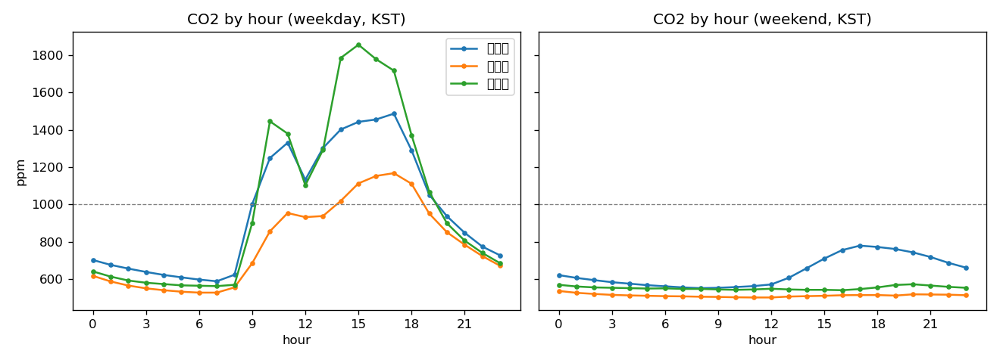

# 과제 2. 데이터 진단서

## 측정 조건
- 데이터: 실데이터 InfluxDB iot-bucket, 2026-07-01 ~ 2026-10-20 (UTC 저장, 패턴은 Asia/Seoul)
- 원본 2,872,162행 → 범위 밖 제거 {'co2': 1069, 'temperature': 0, 'humidity': 22} → 2,871,071행
- 분석 간격 5min, 같은 공간 장치 평균, 10분 이하 결측만 선형 보간

## 1. 센서별 기록 주기
같은 공간에 기록 주기가 다른 센서가 섞이면, 5분 칸마다 평균에 들어가는 센서 수가 달라져 값이 흔들린다.

|                                                  |   rows |   median_interval_min | first                            | last                             |
|:-------------------------------------------------|-------:|----------------------:|:---------------------------------|:---------------------------------|
| ('사무실', '24e124725d081175', 'co2')            | 163246 |                     1 | 2026-07-01 00:00:34.850000+00:00 | 2026-10-20 02:31:21.167000+00:00 |
| ('사무실', '24e124725d081175', 'humidity')       | 163241 |                     1 | 2026-07-01 00:00:34.850000+00:00 | 2026-10-20 02:31:21.167000+00:00 |
| ('사무실', '24e124725d081175', 'temperature')    | 163246 |                     1 | 2026-07-01 00:00:34.850000+00:00 | 2026-10-20 02:31:21.167000+00:00 |
| ('사무실', '24e124785c389010', 'humidity')       | 166482 |                     1 | 2026-07-01 00:00:30.195000+00:00 | 2026-10-20 02:31:12.760000+00:00 |
| ('사무실', '24e124785c389010', 'temperature')    | 166475 |                     1 | 2026-07-01 00:00:30.195000+00:00 | 2026-10-20 02:31:12.760000+00:00 |
| ('사무실 밖', '24e124136d151836', 'humidity')    | 182472 |                     1 | 2026-07-01 00:00:22.324000+00:00 | 2026-10-20 02:31:04.771000+00:00 |
| ('사무실 밖', '24e124136d151836', 'temperature') | 182469 |                     1 | 2026-07-01 00:00:22.324000+00:00 | 2026-10-20 02:31:04.771000+00:00 |
| ('실습실', '24e124126d152590', 'co2')            |  60453 |                     2 | 2026-07-01 00:00:46.260000+00:00 | 2026-10-20 02:29:58.168000+00:00 |
| ('실습실', '24e124126d152590', 'humidity')       |  61506 |                     2 | 2026-07-01 00:00:46.260000+00:00 | 2026-10-20 02:29:58.168000+00:00 |
| ('실습실', '24e124126d152590', 'temperature')    |  61525 |                     2 | 2026-07-01 00:00:46.260000+00:00 | 2026-10-20 02:29:58.168000+00:00 |
| ('실습실', '24e124126d152862', 'co2')            |  85775 |                     2 | 2026-07-01 00:00:58.751000+00:00 | 2026-10-20 02:30:20.238000+00:00 |
| ('실습실', '24e124126d152862', 'humidity')       |  85782 |                     2 | 2026-07-01 00:00:58.751000+00:00 | 2026-10-20 02:30:20.238000+00:00 |
| ('실습실', '24e124126d152862', 'temperature')    |  85778 |                     2 | 2026-07-01 00:00:58.751000+00:00 | 2026-10-20 02:30:20.238000+00:00 |
| ('실습실', '24e124128c067999', 'co2')            | 149326 |                     1 | 2026-07-01 00:00:18.662000+00:00 | 2026-10-20 02:30:47.500000+00:00 |
| ('실습실', '24e124128c067999', 'humidity')       | 149322 |                     1 | 2026-07-01 00:00:18.662000+00:00 | 2026-10-20 02:30:47.500000+00:00 |
| ('실습실', '24e124128c067999', 'temperature')    | 149319 |                     1 | 2026-07-01 00:00:18.662000+00:00 | 2026-10-20 02:30:47.500000+00:00 |
| ('실습실', '24e124128c140101', 'co2')            |  17706 |                    10 | 2026-07-01 00:05:34.694000+00:00 | 2026-10-20 02:25:48.405000+00:00 |
| ('실습실', '24e124128c140101', 'humidity')       |  17607 |                    10 | 2026-07-01 00:05:34.693000+00:00 | 2026-10-20 02:25:48.406000+00:00 |
| ('실습실', '24e124128c140101', 'temperature')    |  17607 |                    10 | 2026-07-01 00:05:34.694000+00:00 | 2026-10-20 02:25:48.406000+00:00 |
| ('실습실', '24e124136d151523', 'humidity')       |  10124 |                    10 | 2026-08-10 05:04:52.766000+00:00 | 2026-10-20 02:27:22.673000+00:00 |
| ('실습실', '24e124136d151523', 'temperature')    |  10124 |                    10 | 2026-08-10 05:04:52.766000+00:00 | 2026-10-20 02:27:22.673000+00:00 |
| ('실습실', '24e124136d151547', 'humidity')       | 116165 |                     1 | 2026-08-07 06:57:05.728000+00:00 | 2026-10-20 02:31:25.984000+00:00 |
| ('실습실', '24e124136d151547', 'temperature')    | 116163 |                     1 | 2026-08-07 06:57:05.728000+00:00 | 2026-10-20 02:31:25.984000+00:00 |
| ('실습실', '24e124136d151606', 'humidity')       | 115510 |                     1 | 2026-08-07 07:00:13.549000+00:00 | 2026-10-20 02:31:18.653000+00:00 |
| ('실습실', '24e124136d151606', 'temperature')    | 115508 |                     1 | 2026-08-07 07:00:13.549000+00:00 | 2026-10-20 02:31:18.653000+00:00 |
| ('실습실', '24e124785c389818', 'humidity')       | 105251 |                     1 | 2026-08-10 05:07:56.395000+00:00 | 2026-10-20 02:31:14.767000+00:00 |
| ('실습실', '24e124785c389818', 'temperature')    | 105248 |                     1 | 2026-08-10 05:07:56.395000+00:00 | 2026-10-20 02:31:14.767000+00:00 |
| ('회의실', '24e124725d089152', 'co2')            |  15997 |                    10 | 2026-07-01 00:08:31.117000+00:00 | 2026-10-20 02:27:14.356000+00:00 |
| ('회의실', '24e124725d089152', 'humidity')       |  15820 |                    10 | 2026-07-01 00:08:31.116000+00:00 | 2026-10-20 02:27:14.356000+00:00 |
| ('회의실', '24e124725d089152', 'temperature')    |  15820 |                    10 | 2026-07-01 00:08:31.117000+00:00 | 2026-10-20 02:27:14.356000+00:00 |

## 2. 결측률 (%)

| space     |   ('보간 전', 'co2') |   ('보간 전', 'humidity') |   ('보간 전', 'temperature') |   ('보간 후', 'co2') |   ('보간 후', 'humidity') |   ('보간 후', 'temperature') |
|:----------|---------------------:|--------------------------:|-----------------------------:|---------------------:|--------------------------:|-----------------------------:|
| 사무실    |                  0   |                       0   |                          0   |                  0   |                       0   |                          0   |
| 사무실 밖 |                100   |                       0   |                          0   |                100   |                       0   |                          0   |
| 실습실    |                  0   |                       0   |                          0   |                  0   |                       0   |                          0   |
| 회의실    |                 50.5 |                      50.7 |                         50.7 |                  0.7 |                       0.8 |                          0.8 |

### 1시간 이상 결측 구간 (긴 순, UTC)

| space     | metric   | start                     | end                       |   hours |
|:----------|:---------|:--------------------------|:--------------------------|--------:|
| 사무실 밖 | co2      | 2026-07-01 00:00:00+00:00 | 2026-10-20 02:35:00+00:00 |  2666.6 |

## 3. 시간대별 CO₂ 평균 (ppm, 한국 시간)

|   ts |   ('실습실', '주말') |   ('실습실', '평일') |   ('사무실', '주말') |   ('사무실', '평일') |   ('회의실', '주말') |   ('회의실', '평일') |
|-----:|---------------------:|---------------------:|---------------------:|---------------------:|---------------------:|---------------------:|
|    0 |                  621 |                  702 |                  536 |                  617 |                  569 |                  641 |
|    1 |                  606 |                  676 |                  526 |                  587 |                  560 |                  613 |
|    2 |                  594 |                  656 |                  520 |                  565 |                  555 |                  592 |
|    3 |                  583 |                  638 |                  515 |                  550 |                  553 |                  580 |
|    4 |                  575 |                  622 |                  512 |                  540 |                  551 |                  573 |
|    5 |                  567 |                  609 |                  510 |                  532 |                  549 |                  566 |
|    6 |                  561 |                  597 |                  508 |                  527 |                  550 |                  564 |
|    7 |                  555 |                  588 |                  507 |                  527 |                  547 |                  562 |
|    8 |                  551 |                  623 |                  505 |                  555 |                  547 |                  569 |
|    9 |                  553 |                 1002 |                  504 |                  685 |                  544 |                  901 |
|   10 |                  557 |                 1249 |                  502 |                  856 |                  542 |                 1446 |
|   11 |                  562 |                 1331 |                  501 |                  954 |                  544 |                 1380 |
|   12 |                  571 |                 1133 |                  501 |                  932 |                  548 |                 1103 |
|   13 |                  607 |                 1303 |                  506 |                  938 |                  544 |                 1293 |
|   14 |                  658 |                 1402 |                  508 |                 1019 |                  542 |                 1786 |
|   15 |                  710 |                 1443 |                  510 |                 1113 |                  542 |                 1857 |
|   16 |                  755 |                 1456 |                  513 |                 1153 |                  540 |                 1779 |
|   17 |                  779 |                 1487 |                  514 |                 1168 |                  546 |                 1718 |
|   18 |                  772 |                 1291 |                  514 |                 1111 |                  555 |                 1372 |
|   19 |                  761 |                 1052 |                  511 |                  951 |                  568 |                 1068 |
|   20 |                  743 |                  937 |                  518 |                  851 |                  572 |                  899 |
|   21 |                  718 |                  848 |                  517 |                  784 |                  565 |                  806 |
|   22 |                  687 |                  774 |                  516 |                  723 |                  558 |                  740 |
|   23 |                  661 |                  727 |                  513 |                  671 |                  553 |                  685 |

## 4. CO₂ 상승 사건과 반응 시간
상승 시작 = 15분 사이 +30ppm 이상(직전 15분은 ±10ppm 이내), 정점까지 +80ppm 이상인 사건만.
일정표가 없어 '사람이 들어온 시각'을 상승 시작으로 근사했다.

| space   |   events |   rise_ppm_median |   to_peak_min_median |   half_decay_min_median |   start_hour_mode |
|:--------|---------:|------------------:|---------------------:|------------------------:|------------------:|
| 실습실  |      169 |               414 |                  170 |                      65 |                 8 |
| 사무실  |      172 |               382 |                  170 |                      60 |                 8 |
| 회의실  |      117 |               922 |                  130 |                      60 |                 9 |

## 5. 평소와 어긋난 평일 (평일 평균 하루 모양과의 RMSE)

### 실습실

| date       |   rmse_ppm |   max_ppm |   mean_profile_max_ppm |
|:-----------|-----------:|----------:|-----------------------:|
| 2026-09-08 |       1306 |      3464 |                   1487 |
| 2026-08-26 |       1216 |      3673 |                   1487 |
| 2026-09-09 |       1132 |      3360 |                   1487 |
| 2026-09-07 |       1047 |      3304 |                   1487 |
| 2026-08-31 |        985 |      3023 |                   1487 |

### 사무실

| date       |   rmse_ppm |   max_ppm |   mean_profile_max_ppm |
|:-----------|-----------:|----------:|-----------------------:|
| 2026-09-03 |        634 |      2627 |                   1168 |
| 2026-07-08 |        612 |      2467 |                   1168 |
| 2026-07-16 |        485 |      2607 |                   1168 |
| 2026-07-07 |        478 |      2232 |                   1168 |
| 2026-07-14 |        424 |      2202 |                   1168 |

### 회의실

| date       |   rmse_ppm |   max_ppm |   mean_profile_max_ppm |
|:-----------|-----------:|----------:|-----------------------:|
| 2026-07-08 |       1028 |      3937 |                   1858 |
| 2026-07-14 |       1018 |      4024 |                   1858 |
| 2026-07-16 |        893 |      4377 |                   1858 |
| 2026-09-03 |        883 |      3786 |                   1858 |
| 2026-07-07 |        847 |      3774 |                   1858 |

## 해석 (직접 작성)
- 결측 원인 추정 (센서 배터리·게이트웨이·수집 중단 중 무엇인지, 시간대가 겹치는지):
- 분석 간격 5분을 고른 근거 (기록 주기 표 참고):
- 평일 패턴과 회의실·실습실 차이:
- CO₂ 반응 시간이 예측 지평(60분)과 경보(30분 전)에 주는 의미:
- 어긋난 날의 이유 (휴일·행사·센서 문제):
