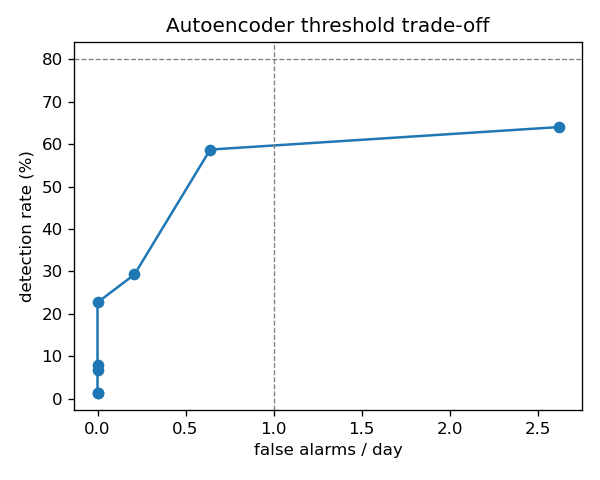

# 과제 4. 이상 탐지

## 측정 조건
- 데이터: 실데이터, 학습(정상) ~2026-09-21, 임계값 결정 = 검증 기간, 시험 2026-10-06 ~ 2026-10-20 (UTC)
- 대상 공간: 실습실, 사무실, 회의실 / 항목: CO₂·온도·습도 / 5분 간격
- 고장 주입: 종류별 15건 (seed 0), 지속 {'spike': 5, 'stuck': 180, 'drift': 360, 'noise': 120, 'dropout': 60} 분, 고장 사이 최소 6시간
- 오토인코더: 1시간(12칸)×3항목×(값, 5분 변화량) 창, 72→32→8→32→72, 30 에폭, 임계값 1.527 (검증 기간 경보 ≤0.5회/일)
- 규칙: 급변 {'co2': 300.0, 'temperature': 3.0, 'humidity': 15.0}, 값 고정 {'co2': 60, 'temperature': 180, 'humidity': 180}분, 범위 밖 {'co2': (350, 5000), 'temperature': (-10, 50), 'humidity': (0, 100)}, 10분 이상 결측
- 값 고정 판정 길이(분): 기본값과 정상(학습+검증) 기간 같은 값 연속 길이 99.9% 분위수 중 긴 쪽: 실습실/co2 60, 실습실/temperature 180, 실습실/humidity 180, 사무실/co2 60, 사무실/temperature 290, 사무실/humidity 215, 회의실/co2 60, 회의실/temperature 830, 회의실/humidity 510
- 잡음 규칙: 최근 1시간 2차 차분 표준편차 > 정상(학습+검증) 기간 99.9% 분위수 × 1.2 (공간·항목별, 시험 기간은 보지 않음): 실습실/co2 153.69, 실습실/temperature 1.30, 실습실/humidity 6.92, 사무실/co2 151.68, 사무실/temperature 0.39, 사무실/humidity 6.03, 회의실/co2 446.21, 회의실/temperature 0.50, 회의실/humidity 4.64
- 탐지 = 고장 시작~끝+30분 안의 경보, 헛경보 = 고장과 겹치지 않는 경보 사건 (전체 공간 합 / 일)

## 결과 (탐지율 %, 지연 분, 원인 항목 일치 %, 헛경보 회/일)

### 규칙

| kind    |   n |   detection_rate |   delay_min_median |   cause_ok_rate |   false_alarms_per_day |
|:--------|----:|-----------------:|-------------------:|----------------:|-----------------------:|
| spike   |  15 |            100   |                0   |           100   |                    0.1 |
| stuck   |  15 |             40   |               55   |            40   |                    0.1 |
| drift   |  15 |              6.7 |              355   |             6.7 |                    0.1 |
| noise   |  15 |             66.7 |               62.5 |            66.7 |                    0.1 |
| dropout |  15 |            100   |                5   |           100   |                    0.1 |
| 전체    |  75 |             62.7 |                5   |            62.7 |                    0.1 |

### 오토인코더

| kind    |   n |   detection_rate |   delay_min_median |   cause_ok_rate |   false_alarms_per_day |
|:--------|----:|-----------------:|-------------------:|----------------:|-----------------------:|
| spike   |  15 |            100   |                  0 |           100   |                    0.2 |
| stuck   |  15 |              0   |                nan |             0   |                    0.2 |
| drift   |  15 |             13.3 |                360 |            13.3 |                    0.2 |
| noise   |  15 |             33.3 |                105 |            33.3 |                    0.2 |
| dropout |  15 |              0   |                nan |             0   |                    0.2 |
| 전체    |  75 |             29.3 |                  0 |            29.3 |                    0.2 |

### 결합 (규칙 OR 오토인코더)

| kind    |   n |   detection_rate |   delay_min_median |   cause_ok_rate |   false_alarms_per_day |
|:--------|----:|-----------------:|-------------------:|----------------:|-----------------------:|
| spike   |  15 |            100   |                0   |           100   |                    0.4 |
| stuck   |  15 |             40   |               55   |            40   |                    0.4 |
| drift   |  15 |             13.3 |              357.5 |            13.3 |                    0.4 |
| noise   |  15 |             73.3 |               65   |            73.3 |                    0.4 |
| dropout |  15 |            100   |                5   |           100   |                    0.4 |
| 전체    |  75 |             65.3 |                5   |            65.3 |                    0.4 |

## 고장을 넣지 않은 원본 시험 기간의 경보 (회/일)
원본에도 진짜 이상이 있을 수 있어, 이 값이 0 이 아니면 경보 시각을 찾아 실제 사례로 확인한다.

|          |   false_alarms_per_day |
|:---------|-----------------------:|
| rules    |                   0.14 |
| ae       |                   0.21 |
| combined |                   0.35 |

### 원본 경보의 원인 규칙 (결합 기준, 한 사건에 원인이 여럿이면 각각 셈)

| causes         |   events |   per_day |
|:---------------|---------:|----------:|
| ae:humidity    |        2 |      0.14 |
| stuck:humidity |        1 |      0.07 |
| gap:*          |        1 |      0.07 |
| ae:co2         |        1 |      0.07 |

### 원본 경보 사건 (앞쪽 10건, UTC) — 실제 수집 끊김·센서 이상인지 확인

| space   | start                     | end                       |   minutes | causes         |
|:--------|:--------------------------|:--------------------------|----------:|:---------------|
| 회의실  | 2026-10-06 05:35:00+00:00 | 2026-10-06 05:40:00+00:00 |        10 | gap:*          |
| 회의실  | 2026-10-07 03:10:00+00:00 | 2026-10-07 03:35:00+00:00 |        30 | ae:co2         |
| 사무실  | 2026-10-07 21:00:00+00:00 | 2026-10-07 21:00:00+00:00 |         5 | stuck:humidity |
| 사무실  | 2026-10-14 10:25:00+00:00 | 2026-10-14 10:30:00+00:00 |        10 | ae:humidity    |
| 사무실  | 2026-10-14 10:40:00+00:00 | 2026-10-14 10:40:00+00:00 |         5 | ae:humidity    |

## 임계값 - 헛경보 곡선 (오토인코더)

|   quantile |   threshold |   detection_rate |   false_alarms_per_day |
|-----------:|------------:|-----------------:|-----------------------:|
|     0.9    |       0.204 |             64   |                   2.62 |
|     0.95   |       0.658 |             58.7 |                   0.64 |
|     0.98   |       1.562 |             29.3 |                   0.21 |
|     0.99   |       3.541 |             22.7 |                   0    |
|     0.995  |       9.477 |              8   |                   0    |
|     0.998  |      16.713 |              6.7 |                   0    |
|     0.999  |      23.111 |              1.3 |                   0    |
|     0.9995 |      47.568 |              1.3 |                   0    |

## 해석 (직접 작성)
- 규칙이 잘 잡는 고장 / 모델이 잘 잡는 고장과 그 이유:
- 결합했을 때 헛경보가 늘어난 만큼 탐지율이 올랐는가:
- 운영 제안 (어떤 임계값, 어떤 경보를 누구에게):
